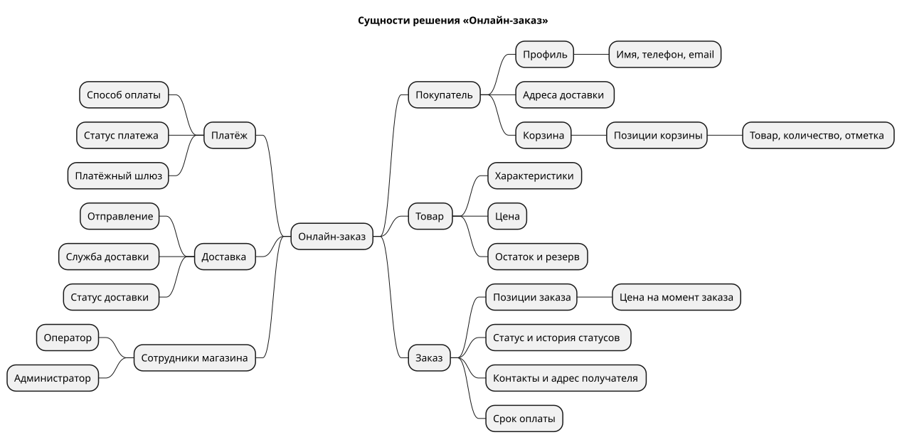

# 1. Описание решения, цели и сущности

> [!NOTE]
> Пример заполнения раздела для решения «Онлайн-заказ в магазине смартфонов».
> Раздел задаёт общий контекст: что делаем, зачем, какими словами это называем и из каких сущностей оно состоит. Все следующие разделы ссылаются на цели (BG-xx) и термины отсюда.

## 1.1 Описание решения

Доработка существующей витрины интернет-магазина смартфонов: покупатель сможет собрать корзину, оформить заказ, оплатить его онлайн и получить с доставкой, не звоня оператору.

- Сейчас витрина только показывает товары, а заказы принимаются по телефону (см. AS IS в [разделе 2](02_business_requirements.md#24-процесс-as-is)).
- Решение добавляет корзину, оформление заказа, онлайн-оплату через внешний платёжный шлюз и передачу заказа во внешнюю службу доставки.
- Решение работает в веб-интерфейсе и в мобильном приложении магазина.
- Остатки товара берутся из учётной системы магазина, синхронизация остатков — вне решения.

## 1.2 Бизнес-цели

| ID | Бизнес-цель | Метрика успеха | Срок оценки |
|----|-------------|----------------|-------------|
| BG-01 | Увеличить объём продаж через онлайн-канал | Рост онлайн-продаж на 50% | 6 месяцев после запуска |
| BG-02 | Сократить время оформления заказа | −40% времени от корзины до оплаты по сравнению с заказом по телефону | 3 месяца после запуска |
| BG-03 | Повысить конверсию посетителей в покупатели | +25% конверсии | 6 месяцев после запуска |
| BG-04 | Обеспечить своевременную доставку | ≥ 95% заказов передаются в доставку в день оплаты | Ежемесячно |
| BG-05 | Защитить данные покупателей и соответствовать 152-ФЗ | Ноль инцидентов с утечкой персональных данных | Постоянно |

> [!TIP]
> Цели пронумерованы, чтобы матрица трассируемости в [разделе 13](13_traceability.md) могла показать, какое требование ведёт к какой цели. Требование, которое не ведёт ни к одной цели, — повод спросить, зачем оно нужно.

## 1.3 Связанные объекты

| Объект | Ссылка | Назначение |
|--------|--------|-----------|
| Задача на внедрение | `https://jira.example.com/browse/SHOP-999` | Эпик в трекере |
| Концепция онлайн-заказа | `https://wiki.example.com/pages/123456790` | Исходное описание идеи от бизнеса |
| Текущая витрина | `https://shop.example.com/catalog/smartphones` | Интерфейс, который дорабатывается |
| Макет в Figma | [Интернет-магазин техники](https://www.figma.com/design/8OWFho9dk1ojDUpLJgITvi/) | Макеты экранов корзины и оформления |
| Документация платёжного шлюза | `https://docs.example-gateway.ru/api` | Контракт E1 и W1 |
| Документация службы доставки | `https://docs.example-delivery.ru/api` | Контракт E2 и W2 |

> [!NOTE]
> Адреса внутренних систем в примере условные: в реальном документе здесь живые ссылки.

## 1.4 Глоссарий

| Термин | Значение |
|--------|----------|
| Решение | Набор доработок программного обеспечения, который закрывает бизнес-задачу. В этом документе — доработка витрины для онлайн-заказа |
| Витрина | Веб-интерфейс и мобильное приложение магазина, где покупатель видит товары, цены и наличие |
| Покупатель | Зарегистрированный пользователь, который оформляет заказ |
| Оператор | Сотрудник магазина, который сопровождает заказы и разбирает заказы, требующие ручной обработки |
| Корзина | Список товаров, которые покупатель собирается купить. У покупателя одна корзина |
| Позиция корзины | Товар в корзине с количеством и отметкой «выбран для заказа» |
| Заказ | Зафиксированное намерение купить выбранные позиции по ценам на момент оформления |
| Резерв | Количество товара, закреплённое за неоплаченными и неотгруженными заказами. Недоступно другим покупателям |
| Свободный остаток | Остаток товара минус резерв. Только его можно добавить в корзину или заказать |
| Срок оплаты | Время, в течение которого заказ можно оплатить, — 30 минут с создания. После этого заказ отменяется и резерв снимается |
| Статус заказа | Этап жизненного цикла заказа: создан, ожидает оплаты, оплачен, передан в доставку, получен, отменён ([раздел 8](08_status_model.md)) |
| Платёжный шлюз | Внешний сервис, который принимает оплату картой и через СБП. Данные карты вводятся только на его странице |
| Служба доставки | Внешняя компания, которая доставляет заказ курьером или в пункт выдачи |
| Отправление | Заказ, принятый службой доставки, с собственным номером |
| Webhook (уведомление) | Входящий запрос от внешней системы, сообщающий об изменении: оплата прошла, заказ доставлен |
| Идемпотентность | Свойство операции давать один результат при повторном вызове. Защищает от двойных заказов и платежей при повторной отправке |
| Конверсия | Доля посетителей, которые совершили покупку |

## 1.5 Сущности решения

Исходник: [`diagrams/01_entities_mindmap.puml`](../diagrams/01_entities_mindmap.puml)

> [!TIP]
> Карта сущностей — черновик будущей модели данных. В [разделе 7](07_data_structure.md) каждая ветка карты превращается в таблицы и поля.
