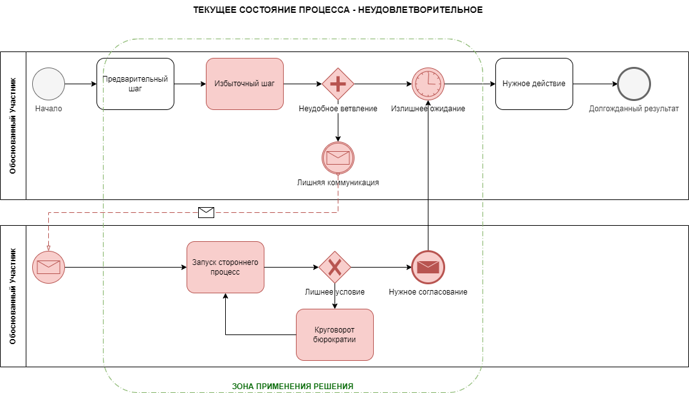
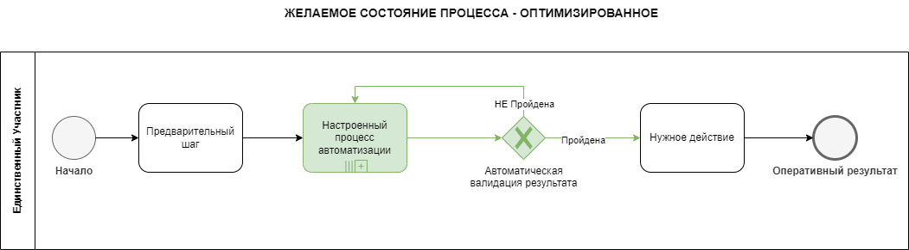
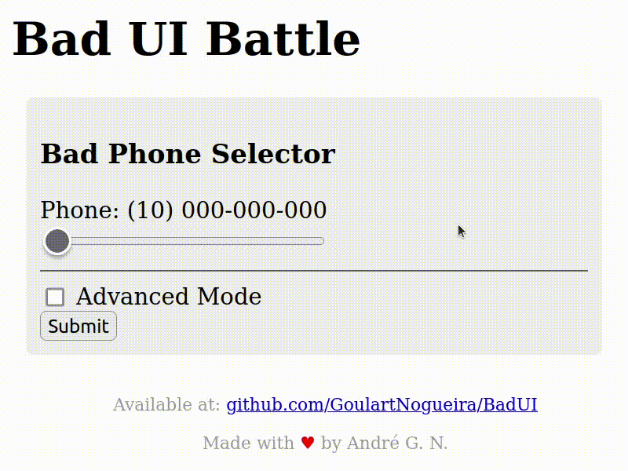
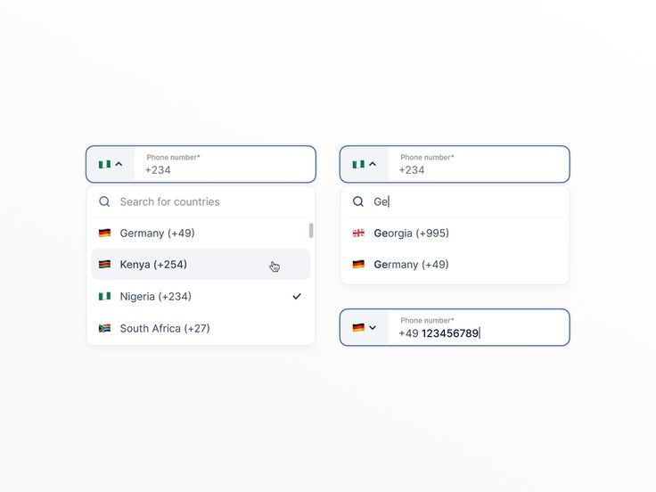

# 2. Бизнес-требования

> [!NOTE]
> Пример заполнения раздела для решения «Онлайн-заказ в магазине смартфонов».
> Раздел описывает задачу языком бизнеса: что нужно, кому, зачем и как изменится процесс. Термины и цели — из [раздела 1](01_solution_overview.md).

## 2.1 Краткое описание бизнес-требований

Нужно дать покупателям возможность оформлять и оплачивать заказы на витрине магазина без звонка оператору:

- покупатель собирает корзину и видит актуальные цены и наличие;
- оформляет заказ из выбранных товаров, вводит контакты и адрес;
- оплачивает заказ картой или через СБП;
- получает заказ курьером или в пункте выдачи и видит его статус;
- магазин не продаёт товар, которого нет на складе, и не теряет заказы при сбоях внешних систем;
- операторы магазина освобождаются от приёма заказов по телефону и занимаются только нестандартными случаями.

## 2.2 Цели решения (5W)

| Вопрос | Ответ |
|--------|-------|
| **Что** нужно сделать? | Добавить на витрину корзину, оформление заказа, онлайн-оплату и передачу заказа в службу доставки |
| **Для кого?** | Для покупателей магазина (веб и мобильное приложение) и для операторов, которые сопровождают заказы |
| **Зачем?** | Увеличить продажи (BG-01), сократить время оформления (BG-02), повысить конверсию (BG-03), доставлять вовремя (BG-04) |
| **Когда?** | Запуск через 6 месяцев: анализ — 1 месяц, разработка и тестирование — 3 месяца, пилот и обучение — 2 месяца |
| **Где?** | В существующей витрине и мобильном приложении; с внешними платёжным шлюзом и службой доставки; остатки — из учётной системы |

## 2.3 Критерии и характеристики решения

| Критерий | Описание |
|----------|----------|
| **KPI** | Рост онлайн-продаж на 50%, конверсия +25%, время оформления −40% (цели BG-01…BG-03 из [раздела 1.2](01_solution_overview.md#12-бизнес-цели)) |
| **Параметры решения** | До 1 000 покупателей одновременно, до 20 заказов в секунду в пиковые дни распродаж, время до открытия платёжной страницы — до 2 секунд, доступность оформления заказа — 99,9%. Обработка персональных данных — по 152-ФЗ. Подробно — НФТ в [разделе 3.3](03_solution_requirements.md#33-нефункциональные-требования-нфт) |
| **Действия при внедрении** | Подключение платёжного шлюза и службы доставки, настройка синхронизации остатков, обучение операторов работе с панелью оператора, пилот на 10% покупателей |
| **Роли в проекте** | Владелец продукта, бизнес- и системный аналитик, 3 разработчика, 2 тестировщика, менеджер внедрения |
| **Сроки** | Анализ — 1 месяц, разработка и тестирование — 3 месяца, пилот и обучение — 2 месяца |
| **Трудозатраты** | ≈ 1 600 человеко-часов: анализ — 160, разработка — 720, тестирование — 480, внедрение и обучение — 240 |
| **Аудитория** | Покупатели магазина; операторы магазина; служба поддержки |

## 2.4 Процесс AS IS

Сейчас витрина только показывает товары. Чтобы купить, покупатель звонит в магазин:

1. Покупатель выбирает товар на сайте и звонит по телефону.
2. Оператор вручную проверяет наличие в учётной системе.
3. Оператор записывает контакты и адрес, создаёт заказ вручную.
4. Покупатель оплачивает курьеру при получении.
5. Оператор вручную передаёт заказ в службу доставки по email.

**Проблемы процесса:**

| Проблема | Последствие |
|----------|-------------|
| Заказ возможен только в часы работы операторов | Теряются покупатели вечером и в выходные |
| Ожидание ответа оператора в часы пик до 10 минут | Покупатели бросают звонок и уходят к конкурентам |
| Ручной ввод контактов и адреса | Ошибки в адресах, повторные доставки |
| Наличие проверяется вручную | Продаётся товар, которого уже нет |
| Оплата только при получении | Отказы при получении, затраты на возврат товара на склад |

## 2.5 Процесс TO BE

1. Покупатель добавляет товары в корзину на сайте или в приложении в любое время.
2. Система сама проверяет наличие и резервирует товар при оформлении заказа.
3. Покупатель вводит контакты и адрес; данные подставляются из профиля и проверяются автоматически.
4. Покупатель оплачивает заказ онлайн на странице платёжного шлюза.
5. После оплаты система сама передаёт заказ в службу доставки и показывает покупателю статус.
6. Оператор подключается только к заказам, которые система не смогла обработать автоматически.

**Что меняется:**

| Было | Стало | Цель |
|------|-------|------|
| Заказ только по телефону в рабочее время | Заказ на сайте и в приложении круглосуточно | BG-01, BG-03 |
| Оператор вручную вносит заказ | Покупатель оформляет заказ сам, данные проверяются автоматически | BG-02 |
| Наличие проверяет оператор | Наличие проверяется и товар резервируется автоматически | BG-01 |
| Оплата при получении | Онлайн-оплата до отправки | BG-01, BG-04 |
| Передача в доставку по email | Автоматическая передача через API службы доставки | BG-04 |

> [!NOTE]
> BPMN-схемы в примере — абстрактные иллюстрации нотации. В реальном документе здесь схемы конкретного процесса.

## 2.6 Интерфейс

| AS IS | TO BE |
|-------|-------|
|  |  |

Полные макеты экранов — в [разделе 4](04_use_cases.md).

## 2.7 Дополнительные материалы

- [IIBA BABOK](https://www.iiba.org/career-resources/a-business-analysis-professionals-foundation-for-success/babok/) — свод знаний по бизнес-анализу
