# 4.1 Сценарий варианта использования

> [!NOTE]
> Пример заполнения раздела для решения «Онлайн-заказ в магазине смартфонов».
> Раздел раскладывает вариант использования UC2 «Заказ товара» из [раздела 4](04_use_cases.md) на шаги, сопоставляет их с макетом и описывает альтернативные пути. На следующем шаге, в [разделе 5](05_integration_api.md), каждый шаг превращается в вызовы API. Номера шагов используются в матрице трассируемости ([раздел 13](13_traceability.md)).

## 4.1.1 Сценарий на макете

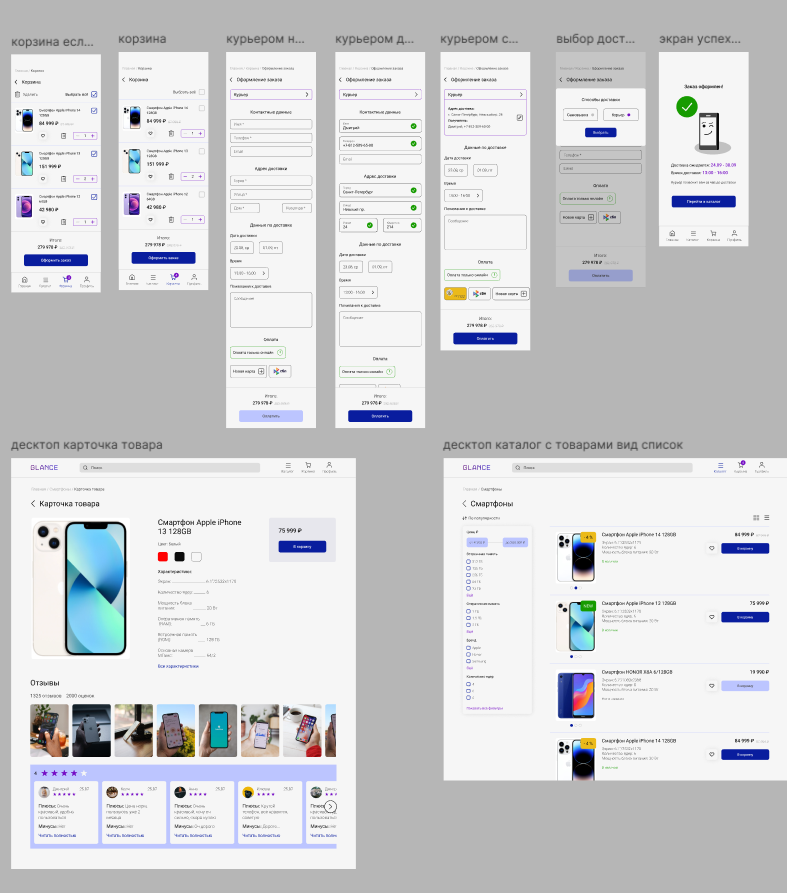

## 4.1.2 Варианты использования, входящие в сценарий

## 4.1.3 Основной сценарий

**Предусловие:** покупатель авторизован и находится в каталоге смартфонов (UC1).
**Результат:** заказ оплачен, передан в службу доставки и получен покупателем.

| UC | № шага | Шаг | Действие в интерфейсе | Макет | API ([раздел 5](05_integration_api.md#53-список-методов-api)) |
|----|:------:|-----|-----------------------|-------|-----|
| UC1 | Предусловие | Просмотр товаров | Покупатель авторизован и открыл раздел «Смартфоны» | 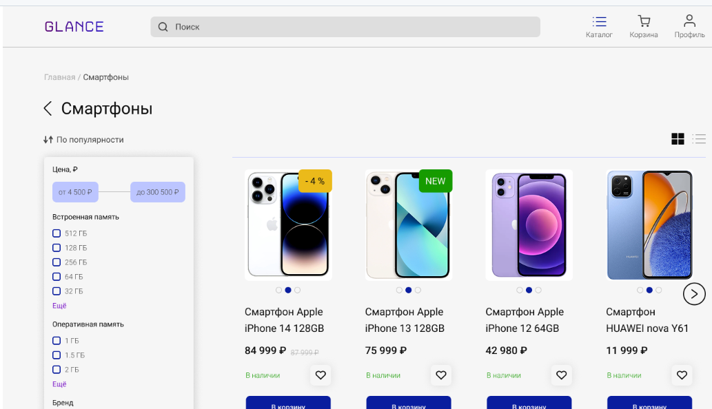 | — |
| UC2.1 | 1 | Добавление товара в корзину | Покупатель нажимает «В корзину» у товара | 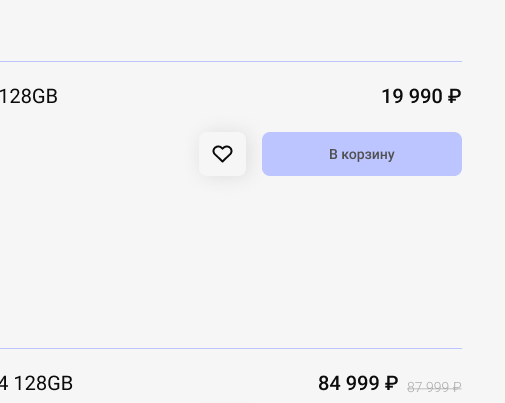 | A1 |
| UC2.1 | 2 | Переход в корзину | Покупатель нажимает «Корзина» в шапке сайта | 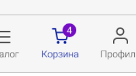 | A2 |
| UC2.2 | 3 | Просмотр добавленных товаров | Покупатель видит позиции, цены, наличие и итог | 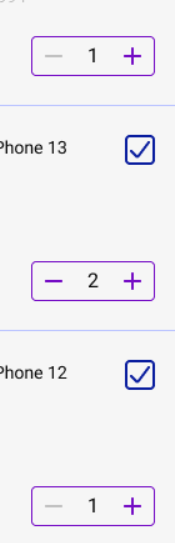 | A2 |
| UC2.2 | 4 | Изменение количества | Покупатель меняет количество у позиции |  | A3 |
| UC2.2 | 5 | Удаление товара | Покупатель нажимает «Удалить» у позиции | 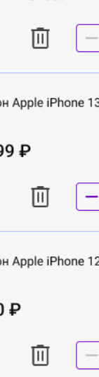 | A4 |
| UC2.2 | 6 | Выбор позиций | Покупатель отмечает позиции или нажимает «Выбрать всё» | 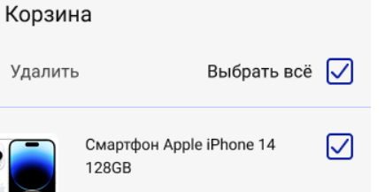 | A5 |
| UC2 | 7 | Проверка итоговой суммы | Покупатель смотрит поле «Итого» по выбранным позициям | 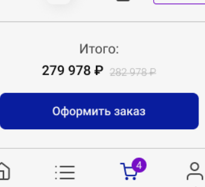 | A2, A5 |
| UC2 | 8 | Оформление заказа | Покупатель нажимает «Оформить заказ» | 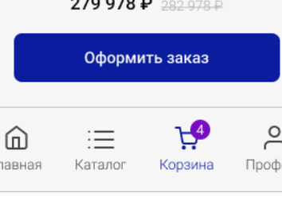 | A6 |
| UC2.3 | 9 | Ввод и проверка данных | Покупатель подтверждает или вводит имя, телефон, email, адрес и способ получения |  | A7, A8 |
| UC2.4 | 10 | Оплата заказа | Покупатель выбирает способ оплаты и оплачивает на странице шлюза |  | A9, E1 |
| UC2.4 | 11 | Подтверждение заказа | Покупатель возвращается в магазин и видит экран подтверждения | 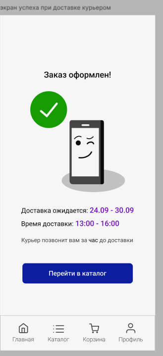 | W1, A10 |
| UC2.5 | 12 | Передача в доставку | Система передаёт заказ в службу доставки, покупатель видит статус «Передан в доставку» | — | E2 |
| UC2.5 | Завершение | Получение заказа | Курьер вручает заказ, статус меняется на «Получен» | — | W2 |

## 4.1.4 Альтернативные пути и исключения

| ID | На шаге | Условие | Что происходит | Возврат в сценарий |
|----|:-------:|---------|----------------|--------------------|
| AF-1 | 10 | Покупатель не оплатил заказ за 30 минут | Система отменяет заказ и снимает резерв, покупатель видит «Заказ отменён» | Нет, сценарий завершён. Покупатель может оформить заказ заново с шага 1 |
| AF-2 | 10 | Оплата не прошла (отказ банка) | Покупатель видит «Оплата не прошла» и кнопку «Оплатить снова» | Шаг 10 |
| AF-3 | 1, 4 | Товара недостаточно на складе или превышен лимит 10 шт. | Количество не меняется, покупатель видит доступный остаток или лимит | Шаг 3 |
| AF-4 | 8 | Цена или наличие изменились с момента просмотра корзины | Заказ не создаётся, покупатель видит новые цены или недоступные позиции | Шаг 7 |
| AF-5 | 9 | Данные введены с ошибкой или адрес вне зоны доставки | Ошибки показываются у полей | Шаг 9 |
| AF-6 | 2–9 | Покупатель отменил заказ до оплаты | Заказ отменён, резерв снят | Нет, сценарий завершён |
| AF-7 | 12 | Служба доставки недоступна | Заказ остаётся оплаченным и попадает в очередь оператора (UC4) | Шаг 12 после обработки оператором |

## 4.1.5 Диаграммы сценария

| Диаграмма активностей | Диаграмма последовательности |
|:---:|:---:|
| 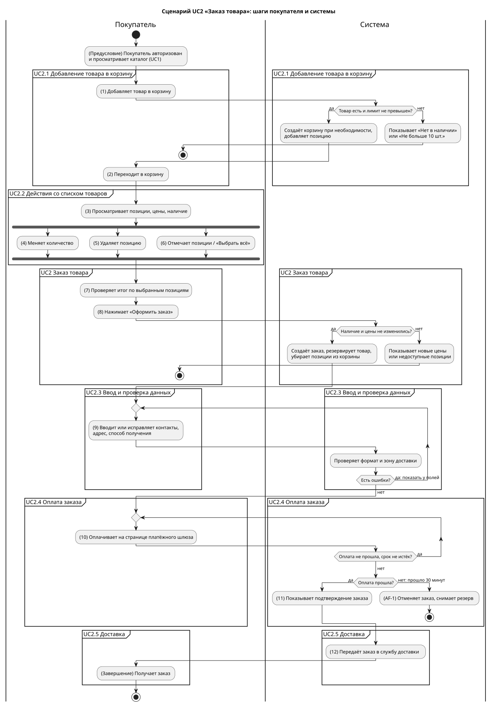 | 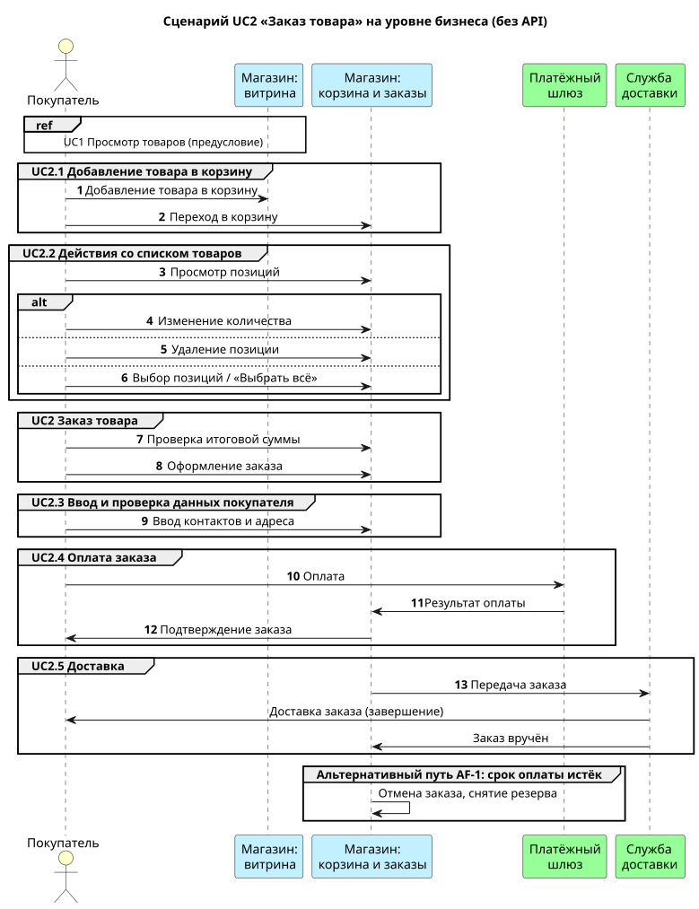 |
| [`04_1_activity.puml`](../diagrams/04_1_activity.puml) | [`04_1_sequence.puml`](../diagrams/04_1_sequence.puml) |

> [!TIP]
> На этом этапе диаграммы показывают шаги на уровне бизнеса, без методов API. Диаграмма активностей лучше показывает ветвления и циклы (повтор оплаты, исправление данных), диаграмма последовательности — кто с кем взаимодействует. Технические вызовы появляются в [разделе 5](05_integration_api.md).
