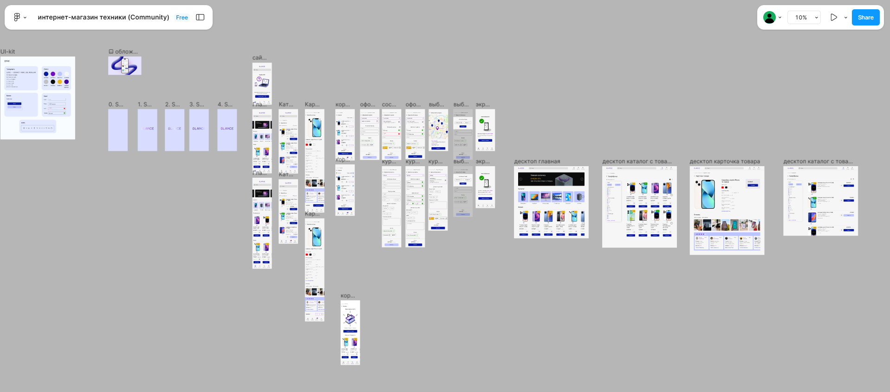
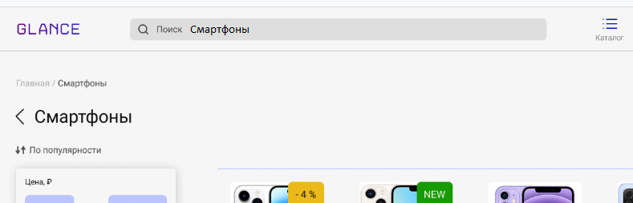
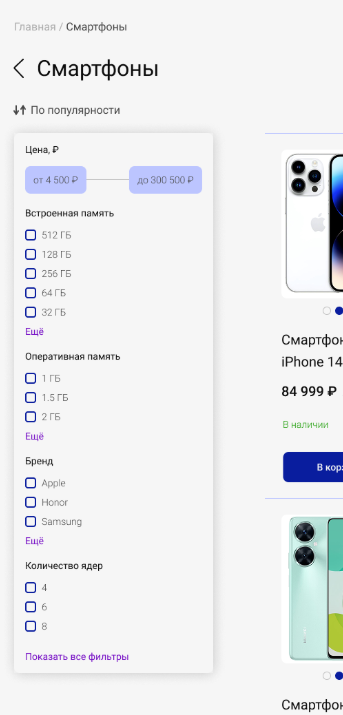
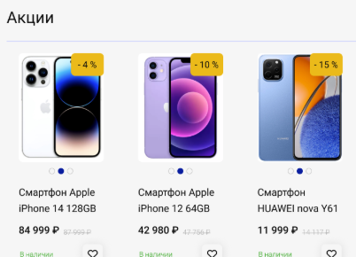

# 4. Варианты использования

> [!NOTE]
> Пример заполнения раздела для решения «Онлайн-заказ в магазине смартфонов».
> Раздел описывает, кто и что делает с решением. Варианты использования (UC) выводятся из макета интерфейса и бизнес-требований ([раздел 2](02_business_requirements.md)), а функциональные требования в [разделе 3](03_solution_requirements.md) ссылаются на них.

## 4.1 Участники

| Участник | Тип | Что делает |
|----------|-----|-----------|
| Покупатель | Человек | Выбирает товары, оформляет и оплачивает заказ |
| Оператор магазина | Человек | Разбирает заказы, которые требуют ручной обработки |
| Платёжный шлюз | Внешняя система | Принимает оплату, сообщает результат |
| Служба доставки | Внешняя система | Доставляет заказ, сообщает статус |

## 4.2 Макет интерфейса

Макет витрины с областями доработки. По нему выводятся варианты использования.

[Макет в Figma](https://www.figma.com/design/8OWFho9dk1ojDUpLJgITvi/)

## 4.3 Диаграмма вариантов использования

Отношение `<<include>>` означает, что вариант использования всегда выполняется в составе родительского (оформление заказа всегда включает ввод данных и оплату). Отношение `<<extend>>` — что вариант дополняет родительский при определённом условии (сравнение цен расширяет просмотр товаров, если у товара есть скидка).

## 4.4 Список вариантов использования

### UC1. Просмотр товаров

Существующая функциональность. В решение не входит, используется как предусловие для UC2.

| № UC | Название | Описание | Макет |
|------|----------|----------|-------|
| UC1 | Просмотр товаров | Покупатель просматривает каталог смартфонов |  |
| UC1.1 | Поиск товара | Покупатель ищет товар по названию |  |
| UC1.2 | Фильтрация товаров | Покупатель фильтрует товары по цене, характеристикам и популярности |  |
| UC1.3 | Сравнение цен | Покупатель видит текущую и прежнюю цену, если действует скидка |  |
| UC1.4 | Просмотр карточки товара | Покупатель смотрит подробные характеристики товара |  |

### UC2. Заказ товара

Основной вариант использования решения.

| № UC | Название | Описание | ФТ | Макет |
|------|----------|----------|----|-------|
| UC2 | Заказ товара | Покупатель проверяет итог по выбранным позициям и оформляет заказ | FR-07, FR-09, FR-10, FR-21 |  |
| UC2.1 | Добавление товара в корзину | Покупатель нажимает «В корзину» в каталоге или карточке товара | FR-01, FR-02 |  |
| UC2.2 | Действия со списком товаров в корзине | Покупатель просматривает корзину, меняет количество, удаляет позиции, отмечает позиции для заказа | FR-03…FR-06, FR-08 |  |
| UC2.3 | Ввод и проверка данных покупателя | Покупатель вводит или подтверждает контакты, адрес и способ получения | FR-11…FR-13 |  |
| UC2.4 | Оплата заказа | Покупатель выбирает способ оплаты и оплачивает заказ на странице шлюза | FR-14…FR-17 |  |
| UC2.5 | Доставка | Заказ передаётся в службу доставки, покупатель видит статус и получает заказ | FR-18…FR-20 |  |

> [!NOTE]
> Проверка наличия товара — не отдельный вариант использования, а серверная проверка внутри UC2.1, UC2.2 и UC2 (бизнес-правило BR-02 в [разделе 10](10_business_rules.md)). Поэтому UC2.2 называется «Действия со списком товаров», а не «Проверка наличия».

### UC3. Навигация

Существующая функциональность, в решение не входит.

| № UC | Название | Описание | Макет |
|------|----------|----------|-------|
| UC3 | Навигация по сайту | Покупатель переходит между главной, каталогом, корзиной и профилем |  |

### UC4. Обработка заказа оператором

| № UC | Название | Описание | ФТ |
|------|----------|----------|----|
| UC4 | Обработка заказа оператором | Оператор находит заказ, разбирает заказы с флагом «требует внимания», повторно передаёт заказ в доставку | FR-24 |

> [!TIP]
> UC4 появился при проработке ошибок внешних систем (NFR-07). Это нормально: варианты использования уточняются, когда становятся понятны исключительные ситуации. Главное — вернуть их в этот раздел, а не оставить только в требованиях.
