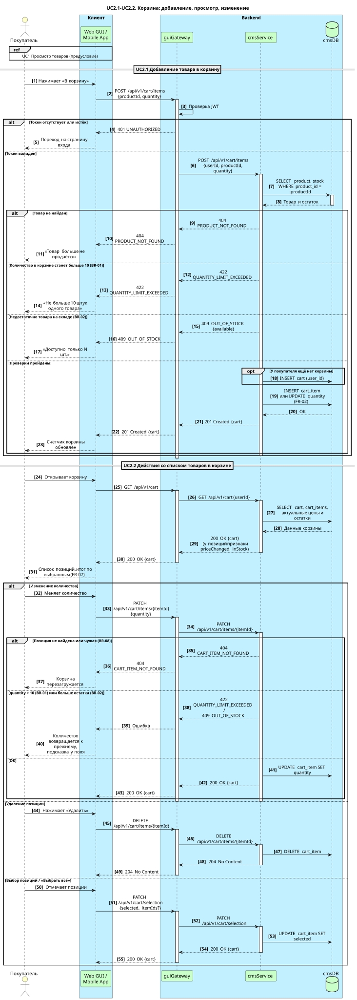
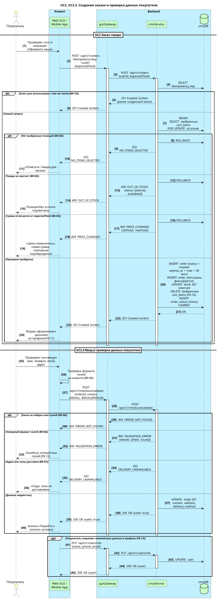
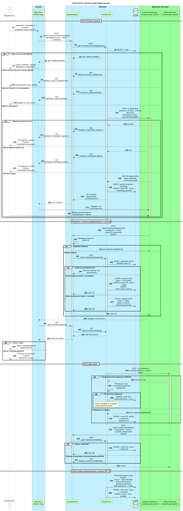

# 5. Интеграционное взаимодействие и API

> [!NOTE]
> Пример заполнения раздела для решения «Онлайн-заказ в магазине смартфонов».
> Раздел превращает сценарий из [раздела 4.1](04.1_use_case_scenario.md) в последовательность вызовов API между компонентами из [раздела 6](06_components.md), включая обработку ошибок. Структуры данных, которые передаются в API, описаны в [разделе 7](07_data_structure.md).

## 5.1 Участники взаимодействия

| Алиас | Компонент | Тип |
|-------|-----------|-----|
| `ugui` | Web GUI и мобильное приложение | Клиент |
| `guiGateway` | API-шлюз: проверка токена, маршрутизация, ограничение частоты запросов | Внутренний сервис |
| `cmsService` | Сервис корзины, заказов и профилей | Внутренний сервис |
| `cmsDB` | База данных PostgreSQL | Хранилище |
| `paymentGateway` | Платёжный шлюз | Внешняя система |
| `deliveryService` | Служба доставки | Внешняя система |

> [!TIP]
> `cmsService` работает с `cmsDB` напрямую через SQL, а не через REST. Поэтому на диаграммах вызовы к базе подписаны операциями `SELECT`, `INSERT`, `UPDATE`, а не HTTP-методами.

**Цветовой код компонентов на диаграммах** (палитра ArchiMate, встроена в PlantUML):

| Цвет | Назначение |
|------|-----------|
| `#Business` | Участник-человек |
| `#Application` | Группа компонентов (клиент, backend) |
| `#Technology` | Внутренний технический компонент |
| `#Physical` | Внешняя система |

---

## 5.2 Диаграммы последовательности

Сценарий разбит на три диаграммы, чтобы каждую можно было прочитать целиком. Ветки `alt` описывают ошибки и альтернативные пути, коды ошибок совпадают с каталогом в [5.4](#каталог-ошибок).

### UC2.1–UC2.2. Корзина



Исходник: [`diagrams/05a_seq_cart.puml`](../diagrams/05a_seq_cart.puml)

### UC2, UC2.3. Создание заказа и проверка данных покупателя



Исходник: [`diagrams/05b_seq_order_checkout.puml`](../diagrams/05b_seq_order_checkout.puml)

### UC2.4–UC2.5. Оплата и доставка



Исходник: [`diagrams/05c_seq_payment_delivery.puml`](../diagrams/05c_seq_payment_delivery.puml)

---

## 5.3 Список методов API

### Публичные методы (вызывает клиент через `guiGateway`)

| № | Название | Метод | URL | Получатель | UC | ФТ |
|---|----------|-------|-----|-----------|----|----|
| A1 | Добавление товара в корзину | POST | `/api/v1/cart/items` | cmsService | UC2.1 | FR-01, FR-02 |
| A2 | Просмотр корзины | GET | `/api/v1/cart` | cmsService | UC2.2 | FR-03, FR-08 |
| A3 | Изменение количества | PATCH | `/api/v1/cart/items/{itemId}` | cmsService | UC2.2 | FR-04 |
| A4 | Удаление позиции | DELETE | `/api/v1/cart/items/{itemId}` | cmsService | UC2.2 | FR-05 |
| A5 | Выбор позиций | PATCH | `/api/v1/cart/selection` | cmsService | UC2.2 | FR-06, FR-07 |
| A6 | Создание заказа | POST | `/api/v1/orders` | cmsService | UC2 | FR-09, FR-10 |
| A7 | Проверка данных покупателя | POST | `/api/v1/checkout/validate` | cmsService | UC2.3 | FR-12 |
| A8 | Изменение профиля | PUT | `/api/v1/users/me` | cmsService | UC2.3 | FR-13 |
| A9 | Инициация оплаты | POST | `/api/v1/orders/{orderId}/payment` | cmsService | UC2.4 | FR-14 |
| A10 | Просмотр заказа | GET | `/api/v1/orders/{orderId}` | cmsService | UC2.4, UC2.5 | FR-16, FR-20 |
| A11 | Отмена заказа | POST | `/api/v1/orders/{orderId}/cancel` | cmsService | UC2 | FR-21 |

### Входящие уведомления от внешних систем (webhook)

| № | Название | Метод | URL | Инициатор | ФТ |
|---|----------|-------|-----|-----------|----|
| W1 | Результат оплаты | POST | `/api/v1/webhooks/payments` | paymentGateway | FR-15 |
| W2 | Изменение статуса доставки | POST | `/api/v1/webhooks/delivery` | deliveryService | FR-19 |

### Исходящие вызовы во внешние системы (вызывает `cmsService`)

| № | Название | Метод | URL | Получатель | ФТ |
|---|----------|-------|-----|-----------|----|
| E1 | Создание платежа | POST | `/v1/payments` | paymentGateway | FR-14 |
| E2 | Создание отправления | POST | `/v1/shipments` | deliveryService | FR-18 |

> [!TIP]
> Полная машиночитаемая спецификация публичных методов и webhook — в файле [`api/openapi.yaml`](../api/openapi.yaml). Ниже — то же самое в виде, удобном для чтения.

---

## 5.4 Обработка ошибок

### Общие правила

- Все ошибки возвращаются в едином формате (ниже) с HTTP-кодом из каталога.
- `traceId` совпадает со значением в логах всех компонентов цепочки (NFR-14). Его показывают пользователю в тексте ошибки 5xx, чтобы поддержка могла найти запрос.
- Клиент показывает пользователю текст по полю `code`, а не по `message`: `message` предназначен для разработчиков и может меняться.
- Для `POST /api/v1/orders` и `POST /api/v1/orders/{orderId}/payment` обязателен заголовок `Idempotency-Key` (BR-10). При таймауте клиент повторяет запрос с тем же ключом.
- Для ошибок 5xx и 429 клиент может повторить запрос не более 3 раз с паузой 1, 2 и 4 секунды. Ошибки 4xx не повторяются.

### Формат ошибки

```json
{
  "error": {
    "code": "OUT_OF_STOCK",
    "message": "Requested quantity exceeds available stock",
    "details": [
      { "itemId": "CI001", "requested": 3, "available": 1 }
    ],
    "traceId": "7f3c9a2e5b1d4f08"
  }
}
```

| Поле | Тип | Обязательное | Описание |
|------|-----|:---:|----------|
| `code` | string | да | Машиночитаемый код ошибки из каталога |
| `message` | string | да | Описание для разработчика |
| `details` | array | нет | Подробности: поля с ошибками, доступные остатки, новые цены |
| `traceId` | string | да | Идентификатор запроса для поиска в логах |

### Каталог ошибок

| HTTP | Код | Когда возникает | Методы | Правило | Реакция интерфейса |
|------|-----|-----------------|--------|---------|--------------------|
| 400 | `VALIDATION_ERROR` | Неверный формат или отсутствует обязательное поле | все | BR-06 | Подсветить поля из `details` |
| 401 | `UNAUTHORIZED` | Нет токена или токен истёк | все публичные | — | Перейти на страницу входа, после входа вернуться |
| 401 | `INVALID_SIGNATURE` | Неверная подпись уведомления | W1, W2 | NFR-10 | — (ответ внешней системе) |
| 403 | `FORBIDDEN` | Роль не имеет права на действие | все | FR-22 | «Недостаточно прав» |
| 404 | `PRODUCT_NOT_FOUND` | Товар снят с продажи | A1 | — | «Товар больше не продаётся» |
| 404 | `CART_ITEM_NOT_FOUND` | Позиции нет или она в чужой корзине | A3, A4 | BR-08 | Перезагрузить корзину |
| 404 | `ORDER_NOT_FOUND` | Заказа нет или он чужой | A7, A9, A10, A11 | BR-08 | «Заказ не найден» |
| 409 | `OUT_OF_STOCK` | Товара на складе меньше, чем запрошено | A1, A3, A6 | BR-02 | Показать доступный остаток |
| 409 | `PRICE_CHANGED` | Сумма заказа не совпала с `expectedTotal` | A6 | BR-03 | Показать новую сумму, запросить подтверждение |
| 409 | `ORDER_EXPIRED` | Истёк срок оплаты, заказ отменён | A9 | BR-05 | «Заказ отменён», предложить оформить заново |
| 409 | `INVALID_STATUS_TRANSITION` | Действие недопустимо в текущем статусе заказа | A9, A11, W2 | BR-09 | Показать актуальный статус |
| 422 | `QUANTITY_LIMIT_EXCEEDED` | Больше 10 штук одного товара | A1, A3 | BR-01 | «Не больше 10 штук одного товара» |
| 422 | `NO_ITEMS_SELECTED` | Не выбрано ни одной позиции | A6 | BR-04 | «Отметьте товары для заказа» |
| 422 | `DELIVERY_UNAVAILABLE` | Адрес вне зоны доставки | A7 | BR-07 | «Сюда пока не доставляем» |
| 422 | `CHECKOUT_DATA_MISSING` | Данные покупателя не проверены | A9 | — | Вернуть на шаг ввода данных |
| 422 | `IDEMPOTENCY_KEY_REUSED` | Ключ уже использован с другим телом запроса | A6, A9 | BR-10 | Ошибка клиента, сгенерировать новый ключ |
| 429 | `RATE_LIMITED` | Превышен лимит запросов (100 в минуту на пользователя) | все публичные | — | Повторить позже |
| 500 | `INTERNAL_ERROR` | Непредвиденная ошибка | все | — | «Что-то пошло не так» + `traceId` |
| 502 | `PAYMENT_PROVIDER_ERROR` | Платёжный шлюз вернул ошибку | A9 | — | «Не удалось начать оплату», кнопка «Повторить» |
| 503 | `SERVICE_UNAVAILABLE` | Сервис временно недоступен | все | NFR-04 | «Сервис временно недоступен» |
| 504 | `PAYMENT_PROVIDER_TIMEOUT` | Платёжный шлюз не ответил за 10 секунд | A9 | NFR-07 | «Не удалось начать оплату», кнопка «Повторить» |

### Ошибки при работе с внешними системами

| Ситуация | Поведение `cmsService` |
|----------|------------------------|
| E1: таймаут или 5xx от платёжного шлюза | Ошибка 504 или 502 возвращается клиенту. Повтор выполняет пользователь, с тем же ключом идемпотентности попытки оплаты. |
| E1: 4xx от платёжного шлюза | Ошибка пишется в лог с телом ответа, клиенту возвращается 502 `PAYMENT_PROVIDER_ERROR`. |
| W1: повторное уведомление с тем же `eventId` | Ответ 200 без изменений: уведомления обрабатываются идемпотентно. |
| W1: уведомление по неизвестному `paymentId` | Ответ 200, событие пишется в лог с уровнем WARN для разбора. |
| E2: таймаут или 5xx от службы доставки | До 5 повторов с паузой 1, 2, 4, 8 и 16 минут. Затем заказу ставится `needs_attention = true`, и он попадает в очередь оператора (NFR-07). |
| W2: статус, недопустимый статусной моделью | Ответ 409 `INVALID_STATUS_TRANSITION`, событие пишется в лог с уровнем WARN. |

---

## 5.5 Описание методов

> [!TIP]
> Для каждого метода указаны: назначение, пример запроса, пример успешного ответа и возможные ошибки из каталога. Заголовок `Authorization: Bearer <token>` обязателен для всех публичных методов и в примерах не повторяется.

### A1. POST /api/v1/cart/items — добавление товара в корзину

Добавляет товар в корзину покупателя. Создаёт корзину, если её нет (FR-01). Если товар уже в корзине, увеличивает количество (FR-02).

<details>
<summary>Запрос и ответ</summary>

```http
POST /api/v1/cart/items HTTP/1.1
Host: shop.example.com
Content-Type: application/json

{
  "productId": "m1125",
  "quantity": 1
}
```

```http
HTTP/1.1 201 Created
Content-Type: application/json

{
  "cartId": "C001",
  "items": [
    {
      "itemId": "CI001",
      "productId": "m1125",
      "name": "Смартфон Apple iPhone 13 128GB",
      "unitPrice": 75999.00,
      "quantity": 1,
      "selected": true,
      "inStock": true,
      "priceChanged": false
    }
  ],
  "selectedTotal": 75999.00,
  "updatedAt": "2026-06-15T12:31:16+03:00"
}
```

</details>

**Ошибки:** 400 `VALIDATION_ERROR`, 401 `UNAUTHORIZED`, 404 `PRODUCT_NOT_FOUND`, 409 `OUT_OF_STOCK`, 422 `QUANTITY_LIMIT_EXCEEDED`

### A2. GET /api/v1/cart — просмотр корзины

Возвращает корзину покупателя с актуальными ценами и остатками. Если корзины нет, возвращает пустую корзину, а не 404.

<details>
<summary>Запрос и ответ</summary>

```http
GET /api/v1/cart HTTP/1.1
Host: shop.example.com
Accept: application/json
```

```http
HTTP/1.1 200 OK
Content-Type: application/json

{
  "cartId": "C001",
  "items": [
    {
      "itemId": "CI001",
      "productId": "m1125",
      "name": "Смартфон Apple iPhone 13 128GB",
      "unitPrice": 74999.00,
      "previousUnitPrice": 75999.00,
      "quantity": 1,
      "selected": true,
      "inStock": true,
      "priceChanged": true
    }
  ],
  "selectedTotal": 74999.00,
  "updatedAt": "2026-06-15T12:40:02+03:00"
}
```

</details>

**Ошибки:** 401 `UNAUTHORIZED`

### A3. PATCH /api/v1/cart/items/{itemId} — изменение количества

<details>
<summary>Запрос и ответ</summary>

```http
PATCH /api/v1/cart/items/CI001 HTTP/1.1
Host: shop.example.com
Content-Type: application/json

{
  "quantity": 2
}
```

```http
HTTP/1.1 200 OK
Content-Type: application/json

{
  "cartId": "C001",
  "items": [
    { "itemId": "CI001", "productId": "m1125", "unitPrice": 75999.00, "quantity": 2, "selected": true, "inStock": true, "priceChanged": false }
  ],
  "selectedTotal": 151998.00,
  "updatedAt": "2026-06-15T12:42:10+03:00"
}
```

</details>

**Ошибки:** 400 `VALIDATION_ERROR`, 401 `UNAUTHORIZED`, 404 `CART_ITEM_NOT_FOUND`, 409 `OUT_OF_STOCK`, 422 `QUANTITY_LIMIT_EXCEEDED`

### A4. DELETE /api/v1/cart/items/{itemId} — удаление позиции

<details>
<summary>Запрос и ответ</summary>

```http
DELETE /api/v1/cart/items/CI001 HTTP/1.1
Host: shop.example.com
```

```http
HTTP/1.1 204 No Content
```

</details>

**Ошибки:** 401 `UNAUTHORIZED`, 404 `CART_ITEM_NOT_FOUND`

### A5. PATCH /api/v1/cart/selection — выбор позиций

Отмечает позиции для заказа. Если `itemIds` не передан, действие применяется ко всем позициям («Выбрать всё»).

<details>
<summary>Запрос и ответ</summary>

```http
PATCH /api/v1/cart/selection HTTP/1.1
Host: shop.example.com
Content-Type: application/json

{
  "selected": true
}
```

```http
HTTP/1.1 200 OK
Content-Type: application/json

{
  "cartId": "C001",
  "items": [
    { "itemId": "CI001", "productId": "m1125", "unitPrice": 75999.00, "quantity": 2, "selected": true, "inStock": true, "priceChanged": false },
    { "itemId": "CI002", "productId": "m2201", "unitPrice": 64990.00, "quantity": 1, "selected": true, "inStock": true, "priceChanged": false }
  ],
  "selectedTotal": 216988.00,
  "updatedAt": "2026-06-15T12:43:55+03:00"
}
```

</details>

**Ошибки:** 400 `VALIDATION_ERROR`, 401 `UNAUTHORIZED`, 404 `CART_ITEM_NOT_FOUND`

### A6. POST /api/v1/orders — создание заказа

Создаёт заказ из выбранных позиций корзины, резервирует товар и фиксирует цены (FR-09, BR-03). Выбранные позиции удаляются из корзины (FR-10). Контактные данные подставляются из профиля (FR-11).

<details>
<summary>Запрос и ответ</summary>

```http
POST /api/v1/orders HTTP/1.1
Host: shop.example.com
Content-Type: application/json
Idempotency-Key: 3b1f6a2c-9d4e-4c51-8a7f-2e6b0c9d1a44

{
  "expectedTotal": 216988.00
}
```

```http
HTTP/1.1 201 Created
Content-Type: application/json

{
  "orderId": "O001",
  "status": "created",
  "items": [
    { "productId": "m1125", "name": "Смартфон Apple iPhone 13 128GB", "unitPrice": 75999.00, "quantity": 2 },
    { "productId": "m2201", "name": "Смартфон Samsung Galaxy S23 128GB", "unitPrice": 64990.00, "quantity": 1 }
  ],
  "total": 216988.00,
  "contact": {
    "name": "Дмитрий",
    "phone": "+78125096500",
    "email": "example@example.com"
  },
  "address": null,
  "expiresAt": "2026-06-15T13:14:00+03:00",
  "createdAt": "2026-06-15T12:44:00+03:00"
}
```

</details>

**Ошибки:** 400 `VALIDATION_ERROR`, 401 `UNAUTHORIZED`, 409 `OUT_OF_STOCK`, 409 `PRICE_CHANGED`, 422 `NO_ITEMS_SELECTED`, 422 `IDEMPOTENCY_KEY_REUSED`

<details>
<summary>Пример ошибки 409 PRICE_CHANGED</summary>

```http
HTTP/1.1 409 Conflict
Content-Type: application/json

{
  "error": {
    "code": "PRICE_CHANGED",
    "message": "Order total differs from expectedTotal",
    "details": [
      { "expectedTotal": 216988.00, "actualTotal": 214988.00 },
      { "productId": "m1125", "oldUnitPrice": 75999.00, "newUnitPrice": 74999.00 }
    ],
    "traceId": "a91c04e7d2b84f3c"
  }
}
```

</details>

### A7. POST /api/v1/checkout/validate — проверка данных покупателя

Проверяет контактные данные и адрес, сохраняет их в заказ (FR-12).

<details>
<summary>Запрос и ответ</summary>

```http
POST /api/v1/checkout/validate HTTP/1.1
Host: shop.example.com
Content-Type: application/json

{
  "orderId": "O001",
  "deliveryMethod": "courier",
  "contact": {
    "name": "Дмитрий",
    "phone": "+78125096500",
    "email": "example@example.com"
  },
  "address": {
    "city": "Санкт-Петербург",
    "street": "Невский проспект",
    "house": "21",
    "apartment": "14",
    "postalCode": "191186"
  }
}
```

```http
HTTP/1.1 200 OK
Content-Type: application/json

{
  "valid": true
}
```

</details>

**Ошибки:** 400 `VALIDATION_ERROR`, 401 `UNAUTHORIZED`, 404 `ORDER_NOT_FOUND`, 422 `DELIVERY_UNAVAILABLE`

<details>
<summary>Пример ошибки 400 VALIDATION_ERROR</summary>

```http
HTTP/1.1 400 Bad Request
Content-Type: application/json

{
  "error": {
    "code": "VALIDATION_ERROR",
    "message": "Request validation failed",
    "details": [
      { "field": "contact.phone", "issue": "must match +7XXXXXXXXXX" },
      { "field": "address.house", "issue": "is required" }
    ],
    "traceId": "c3e8a1f05b7d4e92"
  }
}
```

</details>

### A8. PUT /api/v1/users/me — изменение профиля

Сохраняет изменённые контактные данные в профиль (FR-13). Используется `me` вместо идентификатора пользователя, чтобы нельзя было обратиться к чужому профилю (BR-08).

<details>
<summary>Запрос и ответ</summary>

```http
PUT /api/v1/users/me HTTP/1.1
Host: shop.example.com
Content-Type: application/json

{
  "name": "Дмитрий",
  "phone": "+78125096500",
  "email": "new.email@example.com"
}
```

```http
HTTP/1.1 200 OK
Content-Type: application/json

{
  "userId": "U001",
  "name": "Дмитрий",
  "phone": "+78125096500",
  "email": "new.email@example.com",
  "updatedAt": "2026-06-15T12:47:31+03:00"
}
```

</details>

**Ошибки:** 400 `VALIDATION_ERROR`, 401 `UNAUTHORIZED`

### A9. POST /api/v1/orders/{orderId}/payment — инициация оплаты

Создаёт платёж в платёжном шлюзе и возвращает ссылку на платёжную страницу (FR-14). Данные карты в систему магазина не попадают (NFR-09).

<details>
<summary>Запрос и ответ</summary>

```http
POST /api/v1/orders/O001/payment HTTP/1.1
Host: shop.example.com
Content-Type: application/json
Idempotency-Key: 8c2d7e10-4b3a-4f6e-9a1c-5d0e7f2b3c66

{
  "method": "card"
}
```

```http
HTTP/1.1 201 Created
Content-Type: application/json

{
  "paymentId": "P001",
  "orderId": "O001",
  "status": "pending",
  "amount": 216988.00,
  "confirmationUrl": "https://pay.example-gateway.ru/checkout/2f9a7c1e"
}
```

</details>

**Ошибки:** 401 `UNAUTHORIZED`, 404 `ORDER_NOT_FOUND`, 409 `ORDER_EXPIRED`, 409 `INVALID_STATUS_TRANSITION`, 422 `CHECKOUT_DATA_MISSING`, 422 `IDEMPOTENCY_KEY_REUSED`, 502 `PAYMENT_PROVIDER_ERROR`, 504 `PAYMENT_PROVIDER_TIMEOUT`

### A10. GET /api/v1/orders/{orderId} — просмотр заказа

Возвращает заказ с текущим статусом и историей статусов (FR-16, FR-20).

<details>
<summary>Запрос и ответ</summary>

```http
GET /api/v1/orders/O001 HTTP/1.1
Host: shop.example.com
Accept: application/json
```

```http
HTTP/1.1 200 OK
Content-Type: application/json

{
  "orderId": "O001",
  "status": "paid",
  "total": 216988.00,
  "deliveryMethod": "courier",
  "items": [
    { "productId": "m1125", "name": "Смартфон Apple iPhone 13 128GB", "unitPrice": 75999.00, "quantity": 2 },
    { "productId": "m2201", "name": "Смартфон Samsung Galaxy S23 128GB", "unitPrice": 64990.00, "quantity": 1 }
  ],
  "statusHistory": [
    { "status": "created", "at": "2026-06-15T12:44:00+03:00" },
    { "status": "awaiting_payment", "at": "2026-06-15T12:48:12+03:00" },
    { "status": "paid", "at": "2026-06-15T12:49:40+03:00" }
  ]
}
```

</details>

**Ошибки:** 401 `UNAUTHORIZED`, 404 `ORDER_NOT_FOUND`

### A11. POST /api/v1/orders/{orderId}/cancel — отмена заказа

Отменяет заказ покупателем до передачи в доставку (FR-21) и снимает резерв товара.

<details>
<summary>Запрос и ответ</summary>

```http
POST /api/v1/orders/O001/cancel HTTP/1.1
Host: shop.example.com
Content-Type: application/json

{
  "reason": "changed_mind"
}
```

```http
HTTP/1.1 200 OK
Content-Type: application/json

{
  "orderId": "O001",
  "status": "cancelled"
}
```

</details>

**Ошибки:** 401 `UNAUTHORIZED`, 404 `ORDER_NOT_FOUND`, 409 `INVALID_STATUS_TRANSITION`

> [!NOTE]
> Отмена оплаченного заказа требует возврата денег и в этой версии не поддерживается (см. [раздел 3.1](03_solution_requirements.md#31-границы-решения)). Для оплаченного заказа метод возвращает 409.

### W1. POST /api/v1/webhooks/payments — результат оплаты

Уведомление от платёжного шлюза об изменении статуса платежа (FR-15). Подпись проверяется в `guiGateway` (NFR-10).

<details>
<summary>Запрос и ответ</summary>

```http
POST /api/v1/webhooks/payments HTTP/1.1
Host: shop.example.com
Content-Type: application/json
X-Signature: sha256=5d41402abc4b2a76b9719d911017c592

{
  "eventId": "evt_0f8e2a",
  "paymentId": "P001",
  "orderId": "O001",
  "status": "succeeded",
  "amount": 216988.00,
  "occurredAt": "2026-06-15T12:49:38+03:00"
}
```

```http
HTTP/1.1 200 OK
```

</details>

**Ошибки:** 400 `VALIDATION_ERROR`, 401 `INVALID_SIGNATURE`

### W2. POST /api/v1/webhooks/delivery — изменение статуса доставки

Уведомление от службы доставки (FR-19).

<details>
<summary>Запрос и ответ</summary>

```http
POST /api/v1/webhooks/delivery HTTP/1.1
Host: shop.example.com
Content-Type: application/json
X-Signature: sha256=7215ee9c7d9dc229d2921a40e899ec5f

{
  "eventId": "dlv_77a1c3",
  "shipmentId": "SH-552301",
  "orderId": "O001",
  "status": "delivered",
  "occurredAt": "2026-06-16T15:10:00+03:00"
}
```

```http
HTTP/1.1 200 OK
```

</details>

**Ошибки:** 400 `VALIDATION_ERROR`, 401 `INVALID_SIGNATURE`, 409 `INVALID_STATUS_TRANSITION`

### E1, E2. Контракты внешних систем

> [!TIP]
> Внешние системы описаны минимальным контрактом: только поля, которые использует решение. Полный API — в документации поставщика.

<details>
<summary>E1. POST /v1/payments — создание платежа в платёжном шлюзе</summary>

```http
POST /v1/payments HTTP/1.1
Host: api.example-gateway.ru
Authorization: Basic <shopId:secretKey>
Idempotence-Key: pa_O001_1
Content-Type: application/json

{
  "amount": { "value": "216988.00", "currency": "RUB" },
  "description": "Заказ O001",
  "metadata": { "orderId": "O001" },
  "confirmation": { "type": "redirect", "returnUrl": "https://shop.example.com/orders/O001" }
}
```

```http
HTTP/1.1 200 OK
Content-Type: application/json

{
  "id": "2f9a7c1e-000f-5000-9000-1b2c3d4e5f60",
  "status": "pending",
  "confirmation": { "confirmationUrl": "https://pay.example-gateway.ru/checkout/2f9a7c1e" }
}
```

</details>

<details>
<summary>E2. POST /v1/shipments — создание отправления в службе доставки</summary>

```http
POST /v1/shipments HTTP/1.1
Host: api.example-delivery.ru
Authorization: Bearer <apiKey>
Content-Type: application/json

{
  "externalId": "O001",
  "recipient": { "name": "Дмитрий", "phone": "+78125096500" },
  "address": "191186, Санкт-Петербург, Невский проспект, 21, кв. 14",
  "items": [
    { "sku": "m1125", "quantity": 2 },
    { "sku": "m2201", "quantity": 1 }
  ],
  "declaredValue": 216988.00
}
```

```http
HTTP/1.1 201 Created
Content-Type: application/json

{
  "shipmentId": "SH-552301",
  "status": "accepted"
}
```

</details>
