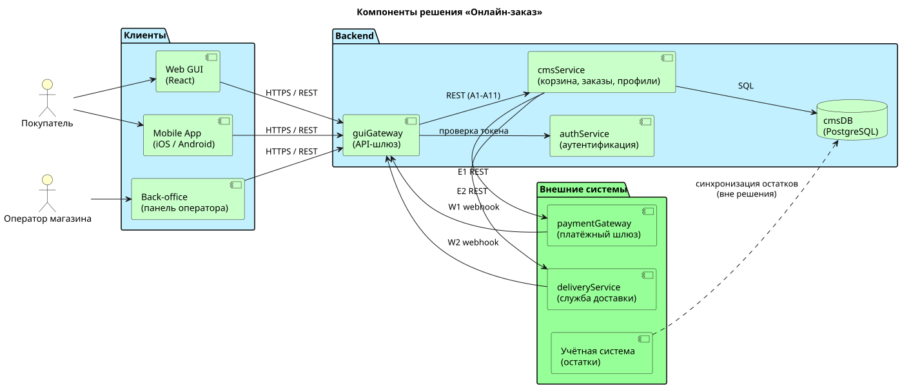

# 6. Компоненты решения

> [!NOTE]
> Пример заполнения раздела для решения «Онлайн-заказ в магазине смартфонов».
> Раздел фиксирует, из каких частей состоит решение, за что отвечает каждая часть и как они связаны. Алиасы компонентов совпадают с участниками диаграмм последовательности в [разделе 5](05_integration_api.md).

## 6.1 Список компонентов

| № | Компонент | Алиас | Ответственность | Технологии | Статус |
|---|-----------|-------|-----------------|-----------|--------|
| 1 | Веб-интерфейс | `ugui` (web) | Витрина, корзина, оформление заказа, личный кабинет | React, TypeScript | Дорабатывается |
| 2 | Мобильное приложение | `ugui` (mobile) | Те же сценарии, что в веб-интерфейсе | Swift (iOS), Kotlin (Android) | Дорабатывается |
| 3 | Панель оператора | `backoffice` | Поиск заказов, просмотр истории, очередь заказов с `needs_attention` (FR-24, NFR-07) | React, TypeScript | Новый |
| 4 | API-шлюз | `guiGateway` | Единая точка входа: проверка JWT, маршрутизация, ограничение частоты запросов, проверка подписи webhook, присвоение `traceId` | Python, FastAPI | Дорабатывается |
| 5 | Сервис аутентификации | `authService` | Вход, выпуск и обновление токенов, роли пользователя (раздел 9) | Существующий сервис | Без изменений |
| 6 | Сервис корзины, заказов и профилей | `cmsService` | Корзина, заказы, статусы, профили покупателей, бизнес-правила BR-01…BR-10, вызовы внешних систем, плановая отмена неоплаченных заказов | Python, FastAPI | Дорабатывается |
| 7 | База данных | `cmsDB` | Товары и остатки, корзины, заказы, платежи, пользователи, история статусов, ключи идемпотентности | PostgreSQL 16 | Дорабатывается |
| 8 | Платёжный шлюз | `paymentGateway` | Приём оплаты картой и через СБП, уведомления о результате | Внешний сервис | Внешний |
| 9 | Служба доставки | `deliveryService` | Создание отправления, доставка, уведомления о статусе | Внешний сервис | Внешний |
| 10 | Учётная система | `erp` | Источник остатков товара (синхронизация вне решения) | Внешняя система | Внешний |

> [!TIP]
> Колонка «Статус» показывает объём работ: «Новый» — компонент создаётся с нуля, «Дорабатывается» — меняется в рамках решения, «Без изменений» — используется как есть, «Внешний» — не разрабатывается командой.

**Почему в примере нет брокера сообщений, кеша и отдельной базы логистики.** Для нагрузки из NFR-03 (до 20 заказов в секунду) достаточно синхронных вызовов и PostgreSQL. Асинхронные процессы (повторные вызовы службы доставки, отмена по таймауту) выполняются плановыми задачами внутри `cmsService`. Если нагрузка вырастет, первым кандидатом на вынос станет очередь вызовов во внешние системы.

---

## 6.2 Диаграмма компонентов

Исходник: [`diagrams/06_components.puml`](../diagrams/06_components.puml)

---

## 6.3 Компоненты, API и данные

Таблица связывает каждый компонент с методами API из [раздела 5.3](05_integration_api.md#53-список-методов-api) и таблицами из [раздела 7](07_data_structure.md).

| Компонент | Предоставляет API | Вызывает API | Работает с данными |
|-----------|-------------------|--------------|--------------------|
| `ugui` | — | A1–A11 | — |
| `backoffice` | — | Методы поиска заказов (вне этого примера) | — |
| `guiGateway` | A1–A11, W1, W2 (внешний контур) | `authService`, `cmsService` | — |
| `authService` | Проверка токена | — | Собственное хранилище пользователей и ролей |
| `cmsService` | A1–A11, W1, W2 (внутренний контур) | E1, E2 | `product`, `stock`, `cart`, `cart_item`, `order`, `order_item`, `order_status_history`, `payment`, `user`, `address`, `idempotency_key` |
| `paymentGateway` | E1 | W1 | — |
| `deliveryService` | E2 | W2 | — |

---

## 6.4 Изменения относительно предыдущей версии примера

| Было | Стало | Причина |
|------|-------|---------|
| `cmsService` обращается к `cmsDB` через REST | Обращение через SQL | База данных не предоставляет REST API |
| Платёжный шлюз и логистика «внутри» `cmsService` | Отдельные внешние системы с контрактом | Это разные поставщики со своими SLA и ошибками |
| Нет мобильного приложения | Добавлено | По заметкам к разделу |
| Kafka, Redis, отдельная БД логистики | Убраны | Не нужны для заявленной нагрузки, см. пояснение выше |
| Нет панели оператора | Добавлена | Нужна для FR-24 и ручной обработки по NFR-07 |
