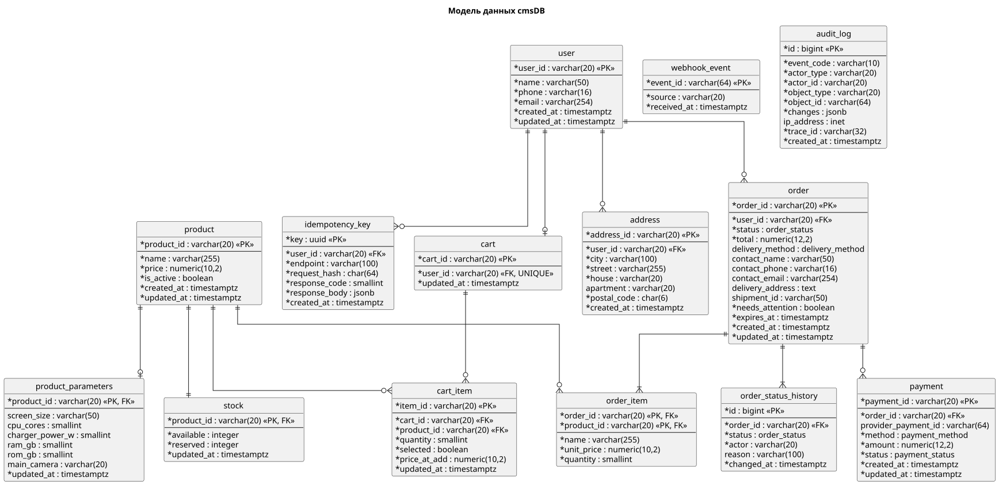

# 7. Структура данных

> [!NOTE]
> Пример заполнения раздела для решения «Онлайн-заказ в магазине смартфонов».
> Раздел описывает таблицы `cmsDB`, которые использует `cmsService` при выполнении сценария из [раздела 5](05_integration_api.md). Поля API в разделе 5 названы в camelCase (`productId`), поля в базе — в snake_case (`product_id`).

## 7.1 Диаграмма модели данных

Исходник: [`diagrams/07_data_model.puml`](../diagrams/07_data_model.puml)

Обозначения: `*` — обязательное поле (`NOT NULL`), `<<PK>>` — первичный ключ, `<<FK>>` — внешний ключ.

---

## 7.2 Перечисления (enum)

| Тип | Значения | Где описан жизненный цикл |
|-----|----------|---------------------------|
| `order_status` | `created`, `awaiting_payment`, `paid`, `in_delivery`, `delivered`, `cancelled` | Раздел 8, статусная модель |
| `payment_status` | `pending`, `succeeded`, `failed`, `cancelled` | Раздел 8, статусная модель |
| `payment_method` | `card`, `sbp` | — |
| `delivery_method` | `courier`, `pickup` | — |

---

## 7.3 Описание таблиц

### `product` — товар

| Поле | Тип | Обяз. | Пример | Описание |
|------|-----|:---:|--------|----------|
| product_id | varchar(20) | PK | `m1125` | Артикул товара |
| name | varchar(255) | да | `Смартфон Apple iPhone 13 128GB` | Название для витрины, корзины и заказа |
| price | numeric(10,2) | да | `75999.00` | Текущая цена, руб. |
| is_active | boolean | да | `true` | Продаётся ли товар. `false` → ошибка `PRODUCT_NOT_FOUND` |
| created_at | timestamptz | да | `2026-05-01T10:00:00+03:00` | Дата создания записи |
| updated_at | timestamptz | да | `2026-06-15T09:12:00+03:00` | Дата последнего изменения, в том числе цены |

### `product_parameters` — характеристики товара

| Поле | Тип | Обяз. | Пример | Описание |
|------|-----|:---:|--------|----------|
| product_id | varchar(20) | PK, FK | `m1125` | Ссылка на `product` |
| screen_size | varchar(50) | нет | `6.1" 2532×1170` | Диагональ и разрешение экрана |
| cpu_cores | smallint | нет | `6` | Количество ядер процессора |
| charger_power_w | smallint | нет | `20` | Мощность зарядки, Вт |
| ram_gb | smallint | нет | `4` | Оперативная память, ГБ |
| rom_gb | smallint | нет | `128` | Встроенная память, ГБ |
| main_camera | varchar(20) | нет | `12+12 Мп` | Основная камера |
| updated_at | timestamptz | да | `2026-05-01T10:00:00+03:00` | Дата последнего изменения |

### `stock` — остатки

| Поле | Тип | Обяз. | Пример | Описание |
|------|-----|:---:|--------|----------|
| product_id | varchar(20) | PK, FK | `m1125` | Ссылка на `product` |
| available | integer | да | `12` | Свободный остаток. Обновляется из учётной системы |
| reserved | integer | да | `3` | Зарезервировано неоплаченными и неотгруженными заказами |
| updated_at | timestamptz | да | `2026-06-15T12:40:00+03:00` | Дата последней синхронизации или резерва |

Ограничения: `available >= 0`, `reserved >= 0`. Товар можно добавить или заказать, если `available - reserved >= запрошенное количество` (BR-02).

### `user` — покупатель

| Поле | Тип | Обяз. | Пример | Описание |
|------|-----|:---:|--------|----------|
| user_id | varchar(20) | PK | `U001` | Идентификатор покупателя (совпадает с `authService`) |
| name | varchar(50) | да | `Дмитрий` | Имя для заказа |
| phone | varchar(16) | да | `+78125096500` | Телефон в формате E.164 (BR-06) |
| email | varchar(254) | да | `example@example.com` | Email (BR-06) |
| created_at | timestamptz | да | `2026-01-20T18:05:00+03:00` | Дата регистрации |
| updated_at | timestamptz | да | `2026-06-15T12:47:31+03:00` | Дата последнего изменения профиля |

### `address` — адреса покупателя

| Поле | Тип | Обяз. | Пример | Описание |
|------|-----|:---:|--------|----------|
| address_id | varchar(20) | PK | `A001` | Идентификатор адреса |
| user_id | varchar(20) | FK | `U001` | Владелец адреса |
| city | varchar(100) | да | `Санкт-Петербург` | Город |
| street | varchar(255) | да | `Невский проспект` | Улица |
| house | varchar(20) | да | `21` | Дом, корпус, строение |
| apartment | varchar(20) | нет | `14` | Квартира или офис |
| postal_code | char(6) | да | `191186` | Почтовый индекс |
| created_at | timestamptz | да | `2026-01-20T18:07:00+03:00` | Дата добавления |

### `cart` — корзина

| Поле | Тип | Обяз. | Пример | Описание |
|------|-----|:---:|--------|----------|
| cart_id | varchar(20) | PK | `C001` | Идентификатор корзины |
| user_id | varchar(20) | FK, UNIQUE | `U001` | Владелец. У покупателя не больше одной корзины |
| updated_at | timestamptz | да | `2026-06-15T12:43:55+03:00` | Дата последнего изменения. Через 30 дней без изменений корзина удаляется (NFR-12) |

Итоговая сумма корзины не хранится: она рассчитывается при каждом запросе по актуальным ценам (FR-07).

### `cart_item` — позиция корзины

| Поле | Тип | Обяз. | Пример | Описание |
|------|-----|:---:|--------|----------|
| item_id | varchar(20) | PK | `CI001` | Идентификатор позиции |
| cart_id | varchar(20) | FK | `C001` | Корзина |
| product_id | varchar(20) | FK | `m1125` | Товар |
| quantity | smallint | да | `2` | Количество, от 1 до 10 (BR-01) |
| selected | boolean | да | `true` | Отмечена ли позиция для заказа (FR-06). По умолчанию `true` |
| price_at_add | numeric(10,2) | да | `75999.00` | Цена в момент добавления. Нужна, чтобы показать изменение цены (FR-08) |
| updated_at | timestamptz | да | `2026-06-15T12:42:10+03:00` | Дата последнего изменения |

Ограничения: `UNIQUE (cart_id, product_id)` — один товар в корзине одной позицией (FR-02); `CHECK (quantity BETWEEN 1 AND 10)`.

### `order` — заказ

| Поле | Тип | Обяз. | Пример | Описание |
|------|-----|:---:|--------|----------|
| order_id | varchar(20) | PK | `O001` | Номер заказа |
| user_id | varchar(20) | FK | `U001` | Покупатель |
| status | order_status | да | `paid` | Текущий статус (раздел 8) |
| total | numeric(12,2) | да | `216988.00` | Сумма заказа по ценам на момент создания |
| delivery_method | delivery_method | нет | `courier` | Способ получения. Заполняется на шаге UC2.3 |
| contact_name | varchar(50) | нет | `Дмитрий` | Имя получателя. Заполняется на шаге UC2.3 |
| contact_phone | varchar(16) | нет | `+78125096500` | Телефон получателя |
| contact_email | varchar(254) | нет | `example@example.com` | Email для чека |
| delivery_address | text | нет | `191186, Санкт-Петербург, Невский проспект, 21, кв. 14` | Адрес на момент заказа. Хранится текстом, чтобы изменение адреса в профиле не меняло старые заказы |
| shipment_id | varchar(50) | нет | `SH-552301` | Номер отправления в службе доставки |
| needs_attention | boolean | да | `false` | Требуется ручная обработка оператором (NFR-07) |
| expires_at | timestamptz | да | `2026-06-15T13:14:00+03:00` | Срок оплаты: создание + 30 минут (BR-05) |
| created_at | timestamptz | да | `2026-06-15T12:44:00+03:00` | Дата создания |
| updated_at | timestamptz | да | `2026-06-15T12:49:40+03:00` | Дата последнего изменения |

### `order_item` — позиция заказа

| Поле | Тип | Обяз. | Пример | Описание |
|------|-----|:---:|--------|----------|
| order_id | varchar(20) | PK, FK | `O001` | Заказ |
| product_id | varchar(20) | PK, FK | `m1125` | Товар |
| name | varchar(255) | да | `Смартфон Apple iPhone 13 128GB` | Название на момент заказа |
| unit_price | numeric(10,2) | да | `75999.00` | Цена на момент заказа (BR-03) |
| quantity | smallint | да | `2` | Количество |

### `order_status_history` — история статусов заказа

| Поле | Тип | Обяз. | Пример | Описание |
|------|-----|:---:|--------|----------|
| id | bigint | PK | `10452` | Идентификатор записи |
| order_id | varchar(20) | FK | `O001` | Заказ |
| status | order_status | да | `paid` | Новый статус |
| actor | varchar(20) | да | `payment` | Кто изменил: `user`, `operator`, `system`, `payment`, `delivery` |
| reason | varchar(100) | нет | `payment_succeeded` | Причина или событие |
| changed_at | timestamptz | да | `2026-06-15T12:49:40+03:00` | Время изменения |

### `payment` — платёж

| Поле | Тип | Обяз. | Пример | Описание |
|------|-----|:---:|--------|----------|
| payment_id | varchar(20) | PK | `P001` | Идентификатор платежа в магазине |
| order_id | varchar(20) | FK | `O001` | Заказ. У заказа может быть несколько попыток оплаты |
| provider_payment_id | varchar(64) | нет | `2f9a7c1e-000f-5000-9000-1b2c3d4e5f60` | Идентификатор в платёжном шлюзе |
| method | payment_method | да | `card` | Способ оплаты |
| amount | numeric(12,2) | да | `216988.00` | Сумма |
| status | payment_status | да | `succeeded` | Статус платежа (раздел 8) |
| created_at | timestamptz | да | `2026-06-15T12:48:12+03:00` | Дата создания |
| updated_at | timestamptz | да | `2026-06-15T12:49:40+03:00` | Дата последнего изменения |

### `webhook_event` — обработанные уведомления

| Поле | Тип | Обяз. | Пример | Описание |
|------|-----|:---:|--------|----------|
| event_id | varchar(64) | PK | `evt_0f8e2a` | Идентификатор события от внешней системы |
| source | varchar(20) | да | `payment` | Источник: `payment` или `delivery` |
| received_at | timestamptz | да | `2026-06-15T12:49:39+03:00` | Время получения |

Нужна, чтобы повторное уведомление не обработалось дважды.

### `idempotency_key` — ключи идемпотентности

| Поле | Тип | Обяз. | Пример | Описание |
|------|-----|:---:|--------|----------|
| key | uuid | PK | `3b1f6a2c-9d4e-4c51-8a7f-2e6b0c9d1a44` | Значение заголовка `Idempotency-Key` |
| user_id | varchar(20) | FK | `U001` | Чей запрос |
| endpoint | varchar(100) | да | `POST /api/v1/orders` | Метод |
| request_hash | char(64) | да | `9f86d081…` | SHA-256 тела запроса. Если тело другое → `IDEMPOTENCY_KEY_REUSED` |
| response_code | smallint | да | `201` | Код первого ответа |
| response_body | jsonb | да | `{"orderId": "O001", …}` | Тело первого ответа, возвращается при повторе |
| created_at | timestamptz | да | `2026-06-15T12:44:00+03:00` | Ключи хранятся 24 часа |

---

## 7.4 Связи между таблицами

| Таблица | Связь | Таблица | Пояснение |
|---------|:-----:|---------|-----------|
| `product` | 1 — 0..1 | `product_parameters` | Характеристики есть не у всех товаров |
| `product` | 1 — 1 | `stock` | У каждого товара одна запись остатка |
| `user` | 1 — 0..* | `address` | Несколько сохранённых адресов |
| `user` | 1 — 0..1 | `cart` | Не больше одной корзины |
| `cart` | 1 — 0..* | `cart_item` | Позиции корзины |
| `product` | 1 — 0..* | `cart_item` | Товар в корзинах разных покупателей |
| `user` | 1 — 0..* | `order` | Заказы покупателя |
| `order` | 1 — 1..* | `order_item` | В заказе хотя бы одна позиция (BR-04) |
| `order` | 1 — 1..* | `order_status_history` | Первая запись создаётся вместе с заказом |
| `order` | 1 — 0..* | `payment` | Несколько попыток оплаты |
| `user` | 1 — 0..* | `idempotency_key` | Ключи запросов покупателя |

---

## 7.5 Изменения относительно предыдущей версии примера

| Было | Стало | Причина |
|------|-------|---------|
| У товара два поля `price`, второе — массив параметров | Параметры вынесены в `product_parameters` со связью 1 к 1 | Дублирование имени поля |
| `uid` и `productid` одновременно | Один ключ `product_id` (аналогично для остальных таблиц) | Два идентификатора одной сущности путают |
| Тип `timestamp`, пример в unix-секундах | `timestamptz`, пример в ISO 8601 | Тип и пример не совпадали, нужен часовой пояс |
| В заказе массив `products` | Таблица `order_item` с ценой на момент заказа | Нужно зафиксировать цену и количество (BR-03) |
| Нет остатков | Таблица `stock` с резервом | Проверка наличия (BR-02) |
| Нет платежей, истории статусов, идемпотентности | Таблицы `payment`, `order_status_history`, `webhook_event`, `idempotency_key` | Требования FR-15, FR-20, NFR-06 |
| Телефон `+7-812-509-65-00` | `+78125096500` | Единый формат E.164 (BR-06) |
