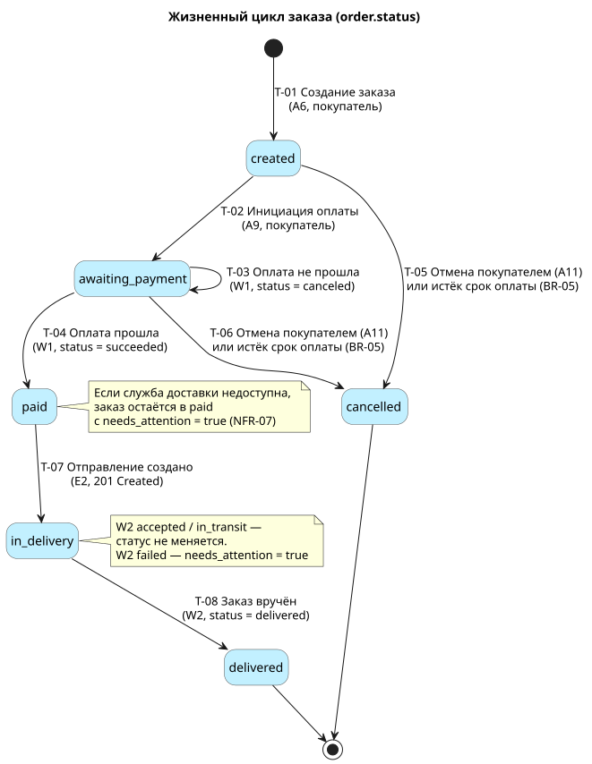
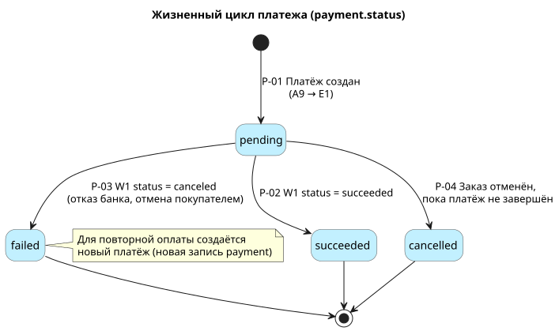

# 8. Статусная модель

> [!NOTE]
> Пример заполнения раздела для решения «Онлайн-заказ в магазине смартфонов».
> Раздел описывает, в каких состояниях бывают заказ и платёж, какие переходы между ними разрешены, кто и каким вызовом API их выполняет. Любой переход, которого нет в таблице, запрещён (BR-09) и возвращает ошибку `INVALID_STATUS_TRANSITION` ([раздел 5.4](05_integration_api.md#каталог-ошибок)).

## 8.1 Статусы заказа

| Статус | Название в интерфейсе | Что означает | Резерв товара | Конечный |
|--------|----------------------|--------------|:---:|:---:|
| `created` | Оформляется | Заказ создан из корзины, покупатель вводит данные | да | нет |
| `awaiting_payment` | Ожидает оплаты | Платёж создан, ждём результат от платёжного шлюза | да | нет |
| `paid` | Оплачен | Деньги получены, заказ передаётся в доставку | да | нет |
| `in_delivery` | Передан в доставку | Служба доставки приняла отправление | списан | нет |
| `delivered` | Получен | Покупатель получил заказ | списан | да |
| `cancelled` | Отменён | Заказ отменён покупателем или по истечении срока оплаты | снят | да |

> [!TIP]
> Отдельно от статуса у заказа есть флаг `needs_attention`. Он не меняет статус, а помечает заказ для ручной обработки оператором: служба доставки недоступна после всех повторов, доставка не удалась, оплата пришла по уже отменённому заказу.

## 8.2 Диаграмма состояний заказа

Исходник: [`diagrams/08a_state_order.puml`](../diagrams/08a_state_order.puml)

## 8.3 Переходы статусов заказа

| ID | Из статуса | В статус | Событие | Инициатор | Вызов | Условия | Побочные действия |
|----|-----------|----------|---------|-----------|-------|---------|-------------------|
| T-01 | — | `created` | Покупатель оформил заказ | Покупатель | A6 | Есть выбранные позиции (BR-04), хватает товара (BR-02), сумма совпала (BR-03) | Резерв товара, удаление позиций из корзины, `expires_at = now + 30 мин` |
| T-02 | `created` | `awaiting_payment` | Покупатель начал оплату | Покупатель | A9 → E1 | Данные покупателя проверены (A7), срок не истёк (BR-05) | Создан платёж `pending` |
| T-03 | `awaiting_payment` | `awaiting_payment` | Оплата не прошла | Платёжный шлюз | W1 | — | Платёж → `failed`, покупатель может оплатить снова |
| T-04 | `awaiting_payment` | `paid` | Оплата прошла | Платёжный шлюз | W1 | Подпись верна (NFR-10), событие новое | Платёж → `succeeded`, запуск передачи в доставку |
| T-05 | `created` | `cancelled` | Отмена покупателем или истёк срок оплаты | Покупатель / система | A11 / плановая задача | — | Резерв снят |
| T-06 | `awaiting_payment` | `cancelled` | Отмена покупателем или истёк срок оплаты | Покупатель / система | A11 / плановая задача | — | Резерв снят, незавершённый платёж → `cancelled` |
| T-07 | `paid` | `in_delivery` | Служба доставки создала отправление | Система | E2 | Ответ 201 от службы доставки | Сохранён `shipment_id`, резерв списан |
| T-08 | `in_delivery` | `delivered` | Заказ вручён | Служба доставки | W2 | Подпись верна, событие новое | — |

Каждый переход записывается в `order_status_history` ([раздел 7](07_data_structure.md)) и в журнал аудита ([раздел 11](11_audit_logging.md)).

## 8.4 Запрещённые переходы (примеры)

| Попытка | Почему запрещено | Ответ |
|---------|------------------|-------|
| `paid` → `cancelled` покупателем | Нужен возврат денег, в этой версии не поддерживается ([раздел 3.1](03_solution_requirements.md#31-границы-решения)) | 409 `INVALID_STATUS_TRANSITION` |
| `cancelled` → `awaiting_payment` (оплата отменённого заказа) | Резерв уже снят, товар мог уйти другому покупателю | 409 `ORDER_EXPIRED` |
| `delivered` → любой статус | Конечный статус | 409 `INVALID_STATUS_TRANSITION` |
| `created` → `paid` минуя `awaiting_payment` | Оплата без созданного платежа невозможна | 409 `INVALID_STATUS_TRANSITION` |
| `in_delivery` → `paid` (повторное или запоздавшее W1) | Статусы не откатываются назад | 200 без изменений: событие уже обработано |

## 8.5 Пограничные случаи

| Ситуация | Поведение |
|----------|-----------|
| Уведомление об успешной оплате пришло после отмены заказа по таймауту | Статус остаётся `cancelled`, платёж → `succeeded`, заказу ставится `needs_attention = true`. Оператор оформляет возврат вручную. |
| Покупатель нажал «Оплатить» дважды | Второй запрос с тем же `Idempotency-Key` возвращает первый платёж (BR-10). С новым ключом — 409 `INVALID_STATUS_TRANSITION`, если первый платёж ещё `pending`. |
| Служба доставки сообщила `failed` | Статус остаётся `in_delivery`, `needs_attention = true`, оператор связывается с покупателем. |
| Служба доставки недоступна после оплаты | Статус остаётся `paid`, до 5 повторов E2, затем `needs_attention = true` (NFR-07). |

---

## 8.6 Статусы платежа

| Статус | Что означает | Конечный |
|--------|--------------|:---:|
| `pending` | Платёж создан в шлюзе, покупатель на платёжной странице | нет |
| `succeeded` | Деньги списаны | да |
| `failed` | Банк отказал или покупатель отменил оплату на странице шлюза | да |
| `cancelled` | Заказ отменён, пока платёж не был завершён | да |

Исходник: [`diagrams/08b_state_payment.puml`](../diagrams/08b_state_payment.puml)

| ID | Из статуса | В статус | Событие | Вызов |
|----|-----------|----------|---------|-------|
| P-01 | — | `pending` | Покупатель начал оплату | A9 → E1 |
| P-02 | `pending` | `succeeded` | Шлюз подтвердил оплату | W1 |
| P-03 | `pending` | `failed` | Шлюз сообщил об отказе | W1 |
| P-04 | `pending` | `cancelled` | Заказ отменён (T-06) | A11 / плановая задача |

> [!TIP]
> Платёж никогда не меняет статус из конечного. Для повторной попытки оплаты создаётся новая запись `payment` с новым ключом идемпотентности.

## 8.7 Соответствие статусов внешних систем

| Внешняя система | Внешний статус | Статус платежа | Статус заказа |
|-----------------|----------------|----------------|---------------|
| paymentGateway (W1) | `succeeded` | `succeeded` | `paid` |
| paymentGateway (W1) | `canceled` | `failed` | без изменений |
| deliveryService (W2) | `accepted`, `in_transit` | — | без изменений (`in_delivery`) |
| deliveryService (W2) | `delivered` | — | `delivered` |
| deliveryService (W2) | `failed` | — | без изменений, `needs_attention = true` |
