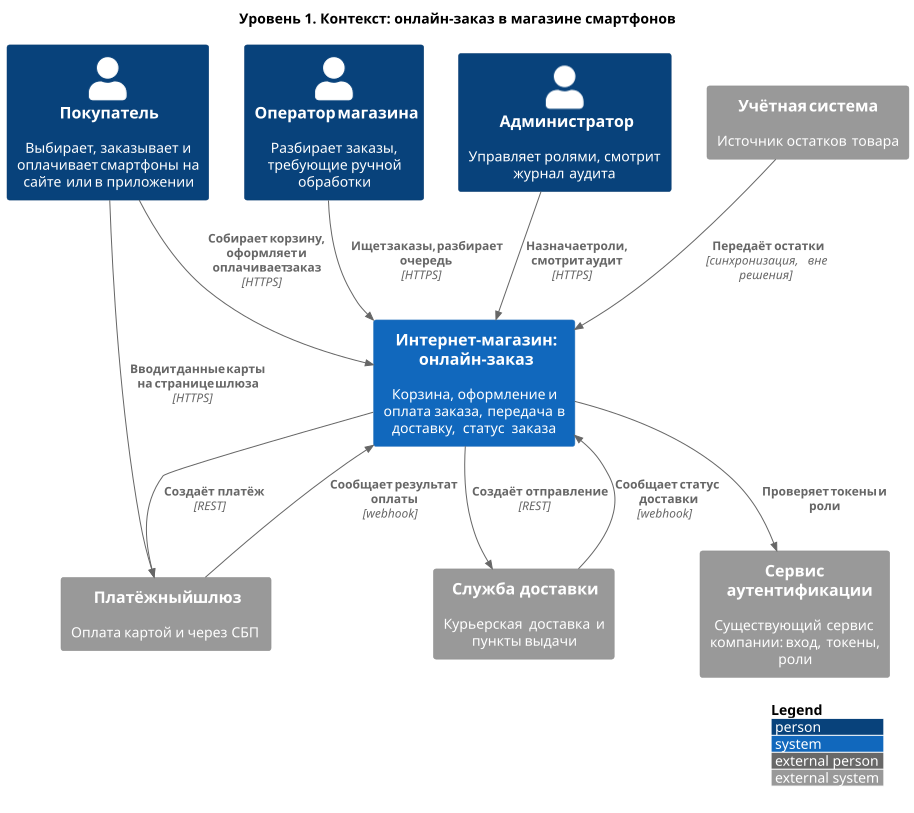

# C4. Уровень 1: контекст

Решение одним блоком: кто им пользуется и с какими внешними системами оно связано.

Исходник: [`diagrams/c4/c4_1_context.puml`](../../diagrams/c4/c4_1_context.puml)

| Участник | Тип | Взаимодействие с решением |
|----------|-----|---------------------------|
| Покупатель | Человек | Собирает корзину, оформляет и оплачивает заказ |
| Оператор магазина | Человек | Ищет заказы, разбирает заказы, требующие ручной обработки |
| Администратор | Человек | Управляет ролями, смотрит журнал аудита |
| Сервис аутентификации | Существующая система | Выдаёт и проверяет токены, хранит роли |
| Платёжный шлюз | Внешняя система | Принимает оплату, сообщает результат |
| Служба доставки | Внешняя система | Доставляет заказ, сообщает статус |
| Учётная система | Внешняя система | Источник остатков (синхронизация вне решения) |

Подробнее об участниках — [раздел 4.1](../04_use_cases.md#41-участники), о ролях — [раздел 9](../09_roles_access.md).
