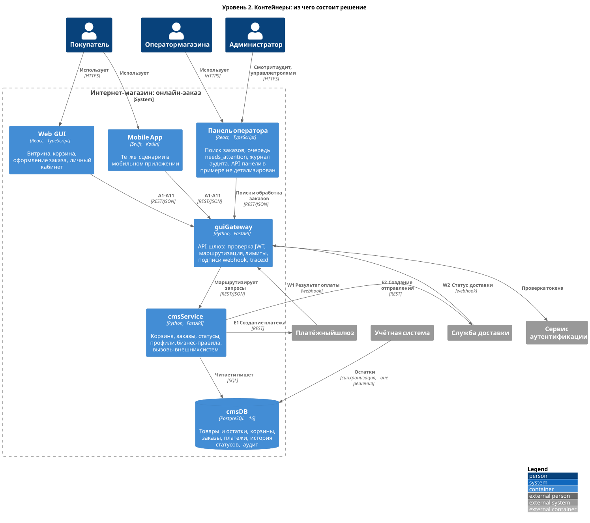

# C4. Уровень 2: контейнеры

Что внутри решения: приложения и хранилища, их технологии и связи. Номера на стрелках — методы API из [раздела 5.3](../05_integration_api.md#53-список-методов-api).

Исходник: [`diagrams/c4/c4_2_containers.puml`](../../diagrams/c4/c4_2_containers.puml)

| Контейнер | Технологии | Ответственность | API |
|-----------|-----------|-----------------|-----|
| Web GUI | React, TypeScript | Витрина, корзина, оформление заказа | Вызывает A1–A11 |
| Mobile App | Swift, Kotlin | Те же сценарии в приложении | Вызывает A1–A11 |
| Панель оператора | React, TypeScript | Поиск заказов, очередь `needs_attention`, журнал аудита | API панели в примере не детализирован |
| guiGateway | Python, FastAPI | Проверка токена, маршрутизация, лимиты, подписи webhook, `traceId` | Принимает A1–A11, W1, W2 |
| cmsService | Python, FastAPI | Корзина, заказы, статусы, правила, вызовы внешних систем | Реализует A1–A11, W1, W2; вызывает E1, E2 |
| cmsDB | PostgreSQL 16 | Все данные решения | SQL от cmsService |

Список компонентов с подробностями — [раздел 6](../06_components.md).
