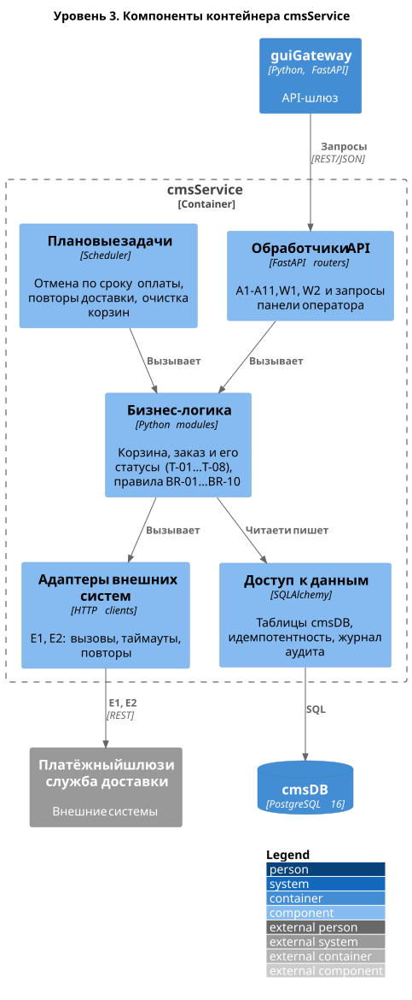

# C4. Уровень 3: компоненты cmsService

Крупные части главного контейнера и связи между ними. Детализирован только `cmsService`: в нём основная логика решения.

Исходник: [`diagrams/c4/c4_3_components_cms.puml`](../../diagrams/c4/c4_3_components_cms.puml)

| Компонент | Ответственность | Связь со спецификацией |
|-----------|-----------------|------------------------|
| Обработчики API | Принимают запросы, проверяют формат, вызывают логику | A1–A11, W1, W2 ([раздел 5](../05_integration_api.md)) |
| Бизнес-логика | Корзина, заказ, переходы статусов, бизнес-правила | T-01…T-08 ([раздел 8](../08_status_model.md)), BR-01…BR-10 ([раздел 10](../10_business_rules.md)) |
| Адаптеры внешних систем | Вызовы платёжного шлюза и службы доставки, таймауты, повторы | E1, E2, NFR-07 |
| Плановые задачи | Отмена неоплаченных заказов, повторы передачи в доставку, очистка корзин | FR-17, NFR-07, NFR-12 |
| Доступ к данным | Таблицы `cmsDB`, ключи идемпотентности, журнал аудита | [Раздел 7](../07_data_structure.md), BR-10, [раздел 11](../11_audit_logging.md) |
