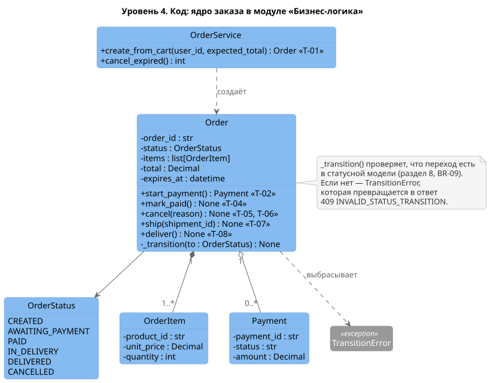

# C4. Уровень 4: код

Ядро компонента «Бизнес-логика»: заказ и переходы его статусов. Это проектный эскиз, а не описание существующего кода: он показывает, как статусная модель из [раздела 8](../08_status_model.md) ложится на классы.

Исходник: [`diagrams/c4/c4_4_code_order.puml`](../../diagrams/c4/c4_4_code_order.puml)

| Элемент | Назначение |
|---------|-----------|
| `OrderService.create_from_cart()` | Создание заказа из корзины — переход T-01 |
| `Order.start_payment()`, `mark_paid()`, `cancel()`, `ship()`, `deliver()` | По одному методу на переход статуса T-02…T-08 |
| `Order._transition()` | Единственное место, где меняется статус. Проверяет переход по статусной модели (BR-09) |
| `TransitionError` | Ошибка недопустимого перехода. Обработчик API превращает её в ответ 409 `INVALID_STATUS_TRANSITION` |
| `OrderService.cancel_expired()` | Вызывается плановой задачей, отменяет заказы с истёкшим сроком оплаты (FR-17) |

> [!TIP]
> Уровень 4 не повторяет модель данных из [раздела 7](../07_data_structure.md): там — таблицы и поля, здесь — где в коде живёт логика. Рисуйте этот уровень только для самой важной или запутанной части.
