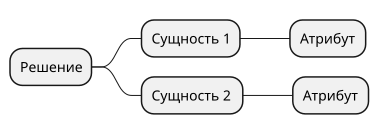
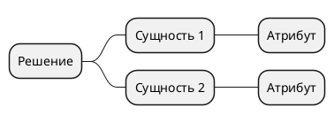

# 1. Описание решения, цели и сущности

> [!NOTE]
> **Зачем раздел:** задать общий контекст — что делаем, зачем, какими словами это называем и из чего оно состоит. Все следующие разделы ссылаются на цели (BG-xx) и термины отсюда.
> **Пример заполнения:** [example/01_solution_overview.md](../example/01_solution_overview.md)

## 1.1 Описание решения

*2–5 предложений: что меняется для пользователя и бизнеса. Что есть сейчас, что добавляем, где это будет работать (веб, мобильное приложение, внутренняя система), что явно не входит.*

## 1.2 Бизнес-цели

| ID | Бизнес-цель | Метрика успеха | Срок оценки |
|----|-------------|----------------|-------------|
| BG-01 | *Чего хочет добиться бизнес* | *Число и единица измерения: «+25% конверсии», «−40% времени»* | *Когда оценивать* |

> [!TIP]
> Цель без метрики — пожелание. Если заказчик не может назвать число, запишите, как будете измерять, и вынесите вопрос о целевом значении в открытые вопросы раздела 3.

## 1.3 Связанные объекты

| Объект | Ссылка | Назначение |
|--------|--------|-----------|
| *Задача в трекере* | *Ссылка* | *Эпик или задача на внедрение* |
| *Концепция, макеты, документация смежных систем* | *Ссылка* | *Зачем нужна читателю* |

## 1.4 Глоссарий

| Термин | Значение |
|--------|----------|
| *Термин* | *Определение в контексте этого решения, одним-двумя предложениями* |

> [!TIP]
> В глоссарий попадают слова, которые разные люди понимают по-разному («заказ», «резерв», «клиент» и «покупатель»), и все термины предметной области. Общие ИТ-термины не нужны.

## 1.5 Сущности решения

*Карта сущностей (mindmap): главные объекты решения и их ключевые атрибуты. Исходник — в `diagrams/01_entities_mindmap.puml`.*

---

### Типичные ошибки

- Описание решения пересказывает техническую реализацию вместо изменения для пользователя.
- Цели сформулированы как действия («внедрить корзину»), а не как результат для бизнеса.
- В глоссарии одно понятие названо двумя словами, и дальше по документу они смешиваются.

### Раздел готов, когда

- [ ] Человек вне команды по разделу 1.1 понимает, что делаем и зачем
- [ ] У каждой цели есть ID и измеримая метрика
- [ ] Все предметные термины, которые встречаются в документе, есть в глоссарии
- [ ] Карта сущностей покрывает объекты, которые появятся в модели данных (раздел 7)
