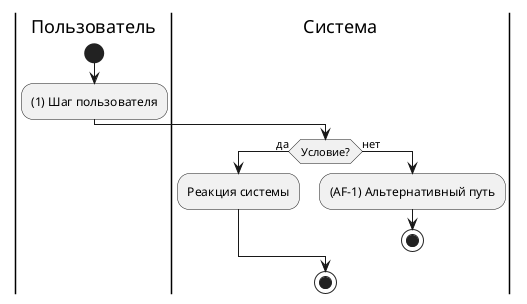

# 4.1 Сценарий варианта использования

> [!NOTE]
> **Зачем раздел:** разложить основной вариант использования на шаги, сопоставить с макетом и описать, что происходит, когда что-то идёт не так. В разделе 5 каждый шаг превратится в вызовы API.
> **Входные данные:** UC из [раздела 4](04_use_cases.md).
> **Пример заполнения:** [example/04.1_use_case_scenario.md](../example/04.1_use_case_scenario.md)

## 4.1.1 Сценарий на макете

*Макет с пронумерованными шагами сценария. Если интерфейса нет — удалите подраздел.*

## 4.1.2 Основной сценарий

**Предусловие:** *что должно быть выполнено до начала*
**Результат:** *чем заканчивается успешный сценарий*

| UC | № шага | Шаг | Действие в интерфейсе | Макет | API (раздел 5) |
|----|:------:|-----|-----------------------|-------|-----|
| UC1 | 1 | *Название шага* | *Что делает пользователь и что видит* | *Фрагмент макета* | A1 |

> [!TIP]
> Один шаг — одно действие участника или одна реакция системы. Колонку «API» заполните после раздела 5: так видно, что у каждого шага есть реализация.

## 4.1.3 Альтернативные пути и исключения

| ID | На шаге | Условие | Что происходит | Возврат в сценарий |
|----|:-------:|---------|----------------|--------------------|
| AF-1 | 1 | *Когда сценарий идёт иначе* | *Что видит пользователь, что делает система* | *На какой шаг или «сценарий завершён»* |

> [!TIP]
> Для каждого шага задайте вопросы: что если данных нет, данные неверные, внешняя система не ответила, пользователь передумал, прошло слишком много времени? Действия, которые система выполняет сама без участия пользователя (отмена по таймауту, ночные задачи), тоже описываются здесь — иначе они теряются.

## 4.1.4 Диаграммы сценария

*Диаграмма активностей (ветвления и циклы) и/или диаграмма последовательности на уровне бизнеса, без методов API. Исходники — в `diagrams/`.*

---

### Типичные ошибки

- Описан только успешный путь.
- Шаги сценария смешаны с техническими деталями (HTTP-коды, таблицы БД) — их место в разделе 5.
- После исправления ошибки пользователем сценарий не возвращается к проверке (на диаграмме нет цикла).

### Раздел готов, когда

- [ ] Каждый шаг пронумерован и привязан к UC
- [ ] Для каждого шага продуманы исключения
- [ ] У каждого альтернативного пути указан возврат или завершение
- [ ] Номера шагов используются в матрице трассируемости (раздел 13)
