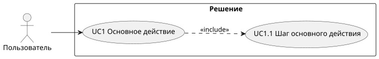
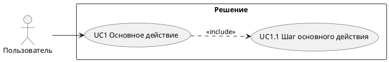

# 4. Варианты использования

> [!NOTE]
> **Зачем раздел:** описать, кто и что делает с решением. Варианты использования (UC) выводятся из макета интерфейса и бизнес-требований, а ФТ в разделе 3 ссылаются на них.
> **Пример заполнения:** [example/04_use_cases.md](../example/04_use_cases.md)

## 4.1 Участники

| Участник | Тип | Что делает |
|----------|-----|-----------|
| *Роль пользователя* | *Человек* | *Цель участника в решении* |
| *Внешняя система* | *Внешняя система* | *Что она делает для решения* |

> [!TIP]
> Внешние системы — тоже участники. Если платёжный шлюз сам присылает результат оплаты, он инициирует действие и должен быть на диаграмме.

## 4.2 Макет интерфейса

*Макет или скриншот с выделенными областями доработки и ссылка на исходник (Figma и т. п.). Если интерфейса нет — удалите подраздел.*

## 4.3 Диаграмма вариантов использования

*Диаграмма: участники, варианты использования и связи `<<include>>` (выполняется всегда в составе родителя) и `<<extend>>` (дополняет родителя при условии).*

## 4.4 Список вариантов использования

| № UC | Название | Описание | ФТ | Макет |
|------|----------|----------|----|-------|
| UC1 | *Глагол + объект: «Заказ товара»* | *Кто и что делает, одним-двумя предложениями* | FR-01 | *Ссылка на фрагмент макета* |
| UC1.1 | *Дочерний вариант использования* | *Описание* | FR-01 | *Ссылка* |

> [!TIP]
> Отметьте варианты использования, которые уже существуют и в решение не входят, но используются как предусловие. Их видно на диаграмме, но требований к ним нет.

---

### Типичные ошибки

- Вариант использования описывает внутреннюю проверку системы («проверка наличия»), а не действие участника.
- Забыты варианты использования для сотрудников: оператора, администратора, поддержки.
- Название UC — существительное («Корзина»), а не действие («Действия с корзиной»).

### Раздел готов, когда

- [ ] У каждого участника есть хотя бы один UC
- [ ] Каждый UC из решения связан хотя бы с одним ФТ
- [ ] Диаграмма и список совпадают
