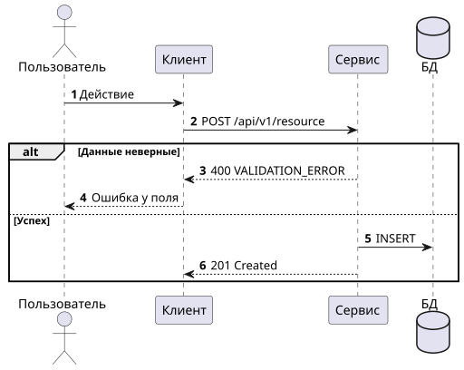
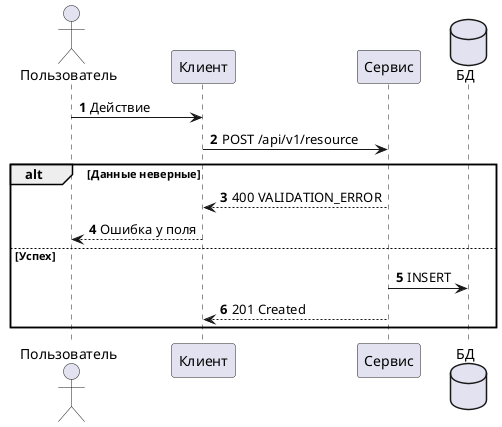

# 5. Интеграционное взаимодействие и API

> [!NOTE]
> **Зачем раздел:** превратить шаги сценария в последовательность вызовов API между компонентами, включая обработку ошибок. По этому разделу разработчики реализуют интеграцию, а тестировщики пишут проверки.
> **Входные данные:** сценарий из [раздела 4.1](04.1_use_case_scenario.md), компоненты из [раздела 6](06_components.md), данные из [раздела 7](07_data_structure.md).
> **Пример заполнения:** [example/05_integration_api.md](../example/05_integration_api.md)

## 5.1 Участники взаимодействия

| Алиас | Компонент | Тип |
|-------|-----------|-----|
| *Короткое имя для диаграмм* | *Название компонента* | *Клиент / Внутренний сервис / Хранилище / Внешняя система* |

## 5.2 Диаграммы последовательности

*По одной диаграмме на крупный блок сценария (корзина, оформление, оплата…). На каждой — основной путь и ветки `alt` для ошибок. Исходники — в `diagrams/05*.puml`.*





> [!TIP]
> Вызовы к базе данных подписывайте операциями SQL (`SELECT`, `INSERT`), а не HTTP-методами: у базы нет REST API. Большой сценарий лучше разбить на несколько диаграмм, чем сделать одну, которую невозможно прочитать.

## 5.3 Список методов API

### Публичные методы

| № | Название | Метод | URL | Получатель | UC | ФТ |
|---|----------|-------|-----|-----------|----|----|
| A1 | *Что делает метод* | *GET / POST / PUT / PATCH / DELETE* | `/api/v1/...` | *Компонент* | UC1 | FR-01 |

### Входящие уведомления от внешних систем

*Таблица в том же формате, номера Wn. Удалите, если внешние системы ничего не присылают.*

### Исходящие вызовы во внешние системы

*Таблица в том же формате, номера En. Удалите, если внешних систем нет.*

## 5.4 Обработка ошибок

### Общие правила

*Единый формат ошибки, какие ошибки клиент может повторять, нужен ли ключ идемпотентности, что такое traceId.*

### Формат ошибки

```json
{
  "error": {
    "code": "ERROR_CODE",
    "message": "Описание для разработчика",
    "details": [],
    "traceId": "..."
  }
}
```

### Каталог ошибок

| HTTP | Код | Когда возникает | Методы | Правило | Реакция интерфейса |
|------|-----|-----------------|--------|---------|--------------------|
| 400 | `VALIDATION_ERROR` | Неверный формат или отсутствует обязательное поле | все | BR-01 | *Что видит пользователь* |
| 401 | `UNAUTHORIZED` | Нет токена или токен истёк | все | — | *Переход на вход* |
| 500 | `INTERNAL_ERROR` | Непредвиденная ошибка | все | — | *Сообщение + traceId* |

> [!TIP]
> Каждое бизнес-правило из раздела 10 обычно порождает свой код ошибки. Скрипт проверки сообщит, если где-то в документе упомянут код, которого нет в этом каталоге.

### Ошибки при работе с внешними системами

| Ситуация | Поведение |
|----------|-----------|
| *Таймаут, 5xx, повторное уведомление, неизвестный объект* | *Повторы, ручная обработка, ответ клиенту* |

## 5.5 Описание методов

### A1. *МЕТОД /api/v1/...* — *назначение*

*Что делает метод и какие ФТ реализует.*

<details>
<summary>Запрос и ответ</summary>

```http
POST /api/v1/... HTTP/1.1
Content-Type: application/json

{ }
```

```http
HTTP/1.1 201 Created
Content-Type: application/json

{ }
```

</details>

**Ошибки:** *коды из каталога*

---

### Типичные ошибки

- Описан только успешный ответ, ошибки «потом».
- Один и тот же смысл ошибки назван по-разному в разных методах.
- Нет идемпотентности для операций, которые нельзя выполнять дважды (создание заказа, платёж).
- Не описано, что делает система, если внешняя система не ответила.

### Раздел готов, когда

- [ ] У каждого шага сценария 4.1 есть вызов API
- [ ] На диаграммах есть ветки ошибок
- [ ] Каждая ошибка из диаграмм есть в каталоге
- [ ] Для каждого метода есть пример запроса, ответа и список ошибок
- [ ] Спецификация в `api/openapi.yaml` совпадает с разделом
