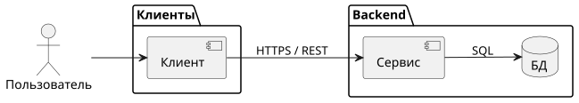
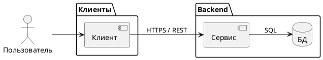

# 6. Компоненты решения

> [!NOTE]
> **Зачем раздел:** зафиксировать, из каких частей состоит решение, за что отвечает каждая и как они связаны. Алиасы компонентов совпадают с участниками диаграмм в разделе 5.
> **Пример заполнения:** [example/06_components.md](../example/06_components.md)

## 6.1 Список компонентов

| № | Компонент | Алиас | Ответственность | Технологии | Статус |
|---|-----------|-------|-----------------|-----------|--------|
| 1 | *Название* | *Алиас из раздела 5* | *За что отвечает, одним предложением* | *Стек* | *Новый / Дорабатывается / Без изменений / Внешний* |

> [!TIP]
> Колонка «Статус» сразу показывает объём работ. Если какой-то популярный компонент (брокер сообщений, кеш) сознательно не используется, напишите почему — этот вопрос зададут на ревью.

## 6.2 Диаграмма компонентов

*Диаграмма компонентов: группы (клиенты, backend, внешние системы), связи с протоколами и номерами API из раздела 5. Исходник — `diagrams/06_components.puml`.*

## 6.3 Компоненты, API и данные

| Компонент | Предоставляет API | Вызывает API | Работает с данными |
|-----------|-------------------|--------------|--------------------|
| *Алиас* | *Номера методов из 5.3* | *Номера методов* | *Таблицы из раздела 7* |

---

### Типичные ошибки

- Компонент «делает всё»: корзину, платежи, логистику. Внешние системы стоит выделять отдельно — у них свои SLA и ошибки.
- База данных показана как сервис с REST API.
- Компоненты на диаграмме и в таблице называются по-разному.

### Раздел готов, когда

- [ ] Каждый участник диаграмм раздела 5 есть в списке компонентов
- [ ] У каждого компонента понятны ответственность и статус
- [ ] Таблица 6.3 связывает компоненты с API и данными
