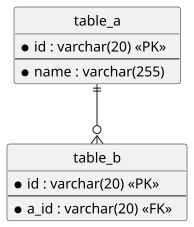
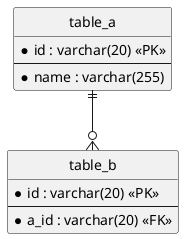

# 7. Структура данных

> [!NOTE]
> **Зачем раздел:** описать данные, с которыми работает решение: таблицы, поля, типы, ограничения и связи.
> **Входные данные:** сущности из раздела 1.5, тела запросов и ответов из раздела 5.
> **Пример заполнения:** [example/07_data_structure.md](../example/07_data_structure.md)

## 7.1 Диаграмма модели данных

*ER-диаграмма: таблицы, ключевые поля, связи с кратностью. Исходник — `diagrams/07_data_model.puml`.*

## 7.2 Перечисления (enum)

| Тип | Значения | Где описан жизненный цикл |
|-----|----------|---------------------------|
| *Имя типа* | *Список значений* | *Раздел 8, если это статус* |

## 7.3 Описание таблиц

### `table_name` — *назначение таблицы*

| Поле | Тип | Обяз. | Пример | Описание |
|------|-----|:---:|--------|----------|
| *id* | *varchar(20)* | PK | *Пример значения* | *Что хранит поле* |

*Ограничения таблицы: уникальность, CHECK, правила удаления.*

> [!TIP]
> Пример значения должен совпадать с типом: не пишите тип `timestamp`, а пример в unix-секундах. Значения, которые фиксируются в момент события (цена в заказе, адрес доставки), храните копией, а не ссылкой на изменяемый справочник.

## 7.4 Связи между таблицами

| Таблица | Связь | Таблица | Пояснение |
|---------|:-----:|---------|-----------|
| *table_a* | *1 — 0..** | *table_b* | *Смысл связи* |

---

### Типичные ошибки

- Одна сущность имеет два идентификатора, и непонятно, какой использовать.
- Нет полей для статусов, истории, идемпотентности, аудита — они появляются только в разделах 8–11 и не попадают в модель.
- Поля в API и в базе называются по-разному без объяснения правила (camelCase в API, snake_case в базе — нормально, но это нужно написать).

### Раздел готов, когда

- [ ] Каждое поле из запросов и ответов раздела 5 можно найти в модели или объяснить, как оно вычисляется
- [ ] У каждого поля есть тип, обязательность и пример
- [ ] Перечисления совпадают со статусами раздела 8
- [ ] Диаграмма и описание таблиц совпадают
