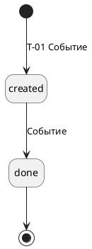

# 8. Статусная модель

> [!NOTE]
> **Зачем раздел:** описать, в каких состояниях бывают ключевые объекты, какие переходы разрешены, кто и каким вызовом их выполняет. Любой переход, которого нет в таблице, запрещён.
> **Пример заполнения:** [example/08_status_model.md](../example/08_status_model.md)

## 8.1 Статусы объекта

| Статус | Название в интерфейсе | Что означает | Конечный |
|--------|----------------------|--------------|:---:|
| *code* | *Как видит пользователь* | *Что произошло с объектом* | *да / нет* |

## 8.2 Диаграмма состояний

*Диаграмма состояний с ID переходов на стрелках. Исходник — `diagrams/08*.puml`.*

## 8.3 Переходы

| ID | Из статуса | В статус | Событие | Инициатор | Вызов | Условия | Побочные действия |
|----|-----------|----------|---------|-----------|-------|---------|-------------------|
| T-01 | — | *статус* | *Что произошло* | *Роль или система* | A1 | *Что должно выполняться* | *Что ещё меняется: резерв, уведомление, запись в историю* |

> [!TIP]
> Для каждого перехода задайте вопрос: что если событие придёт дважды или в неправильном порядке? Ответ — в 8.4 и 8.5.

## 8.4 Запрещённые переходы

| Попытка | Почему запрещено | Ответ |
|---------|------------------|-------|
| *Из какого в какой* | *Причина* | *Код ошибки из каталога раздела 5* |

## 8.5 Пограничные случаи

| Ситуация | Поведение |
|----------|-----------|
| *Гонки, запоздавшие и повторные события, отмена во время обработки* | *Что делает система* |

---

### Типичные ошибки

- Статусы описаны, а кто их меняет — нет.
- Нет конечных статусов, или из конечного статуса есть переход.
- Статус внешней системы (платёжного шлюза, доставки) используется как статус своего объекта без таблицы соответствия.

### Раздел готов, когда

- [ ] У каждого перехода есть ID, инициатор и вызов
- [ ] Перечисление статусов совпадает с разделом 7
- [ ] Описаны повторные и запоздавшие события
- [ ] Каждый переход упомянут в матрице раздела 13
