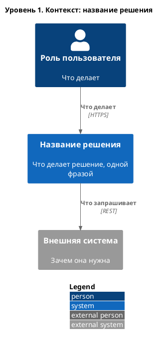

# C4. Уровень 1: контекст

*Решение одним блоком, вокруг — люди и внешние системы. Без технологий и внутреннего устройства.*

| Участник | Тип | Взаимодействие с решением |
|----------|-----|---------------------------|
| *Название* | *Человек / Существующая система / Внешняя система* | *Что делает с решением или для него* |

> [!TIP]
> Если внешняя система сама присылает данные (webhook), нарисуйте отдельную стрелку от неё к решению: направление показывает, кто инициирует обмен.
