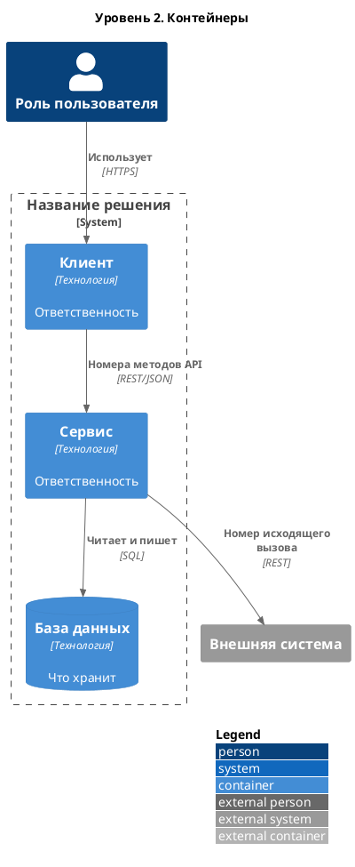

# C4. Уровень 2: контейнеры

*Что внутри решения: приложения, сервисы и хранилища. «Контейнер» в C4 — это то, что отдельно запускается или разворачивается, а не Docker-контейнер.*

| Контейнер | Технологии | Ответственность | API |
|-----------|-----------|-----------------|-----|
| *Название* | *Стек* | *За что отвечает* | *Какие методы из раздела 5 предоставляет или вызывает* |

> [!TIP]
> Контейнеры на этом уровне должны совпадать со списком компонентов в разделе 6. Если здесь появился контейнер, которого там нет, — один из документов устарел.
