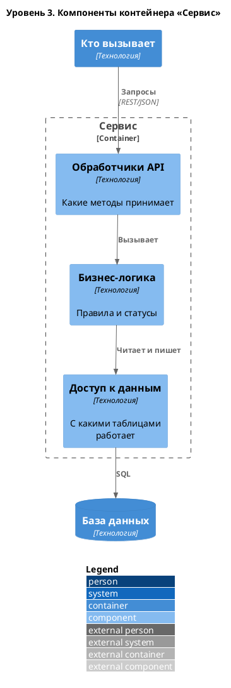

# C4. Уровень 3: компоненты

*Крупные части одного контейнера. Рисуйте только для контейнера, где живёт основная логика. Хватает 4–7 блоков.*

| Компонент | Ответственность | Связь со спецификацией |
|-----------|-----------------|------------------------|
| *Название* | *За что отвечает* | *Методы API, правила BR-xx, переходы T-xx, таблицы* |

> [!TIP]
> Колонка «Связь со спецификацией» показывает, где в коде будет реализовано каждое требование. Если правило из раздела 10 не попадает ни в один компонент, его, скорее всего, забудут.
