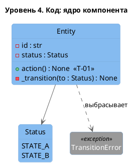

# C4. Уровень 4: код

*Классы ядра одного компонента — только для самой важной или запутанной логики. Это проектный эскиз, а не документация всего кода.*

| Элемент | Назначение |
|---------|-----------|
| *Класс или метод* | *Что делает и какой переход, правило или требование реализует* |

> [!TIP]
> Не повторяйте здесь модель данных из раздела 7: там таблицы и поля, здесь — где в коде живёт логика. Хороший кандидат для уровня 4 — статусная модель из раздела 8: один метод на каждый переход и одно место, где проверяется допустимость перехода.
